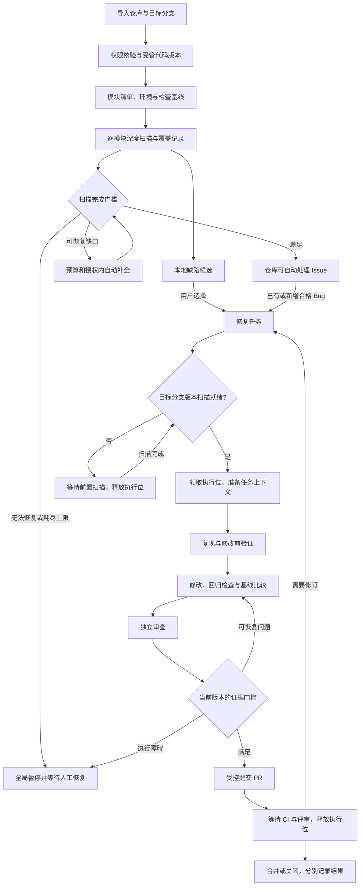

# 架构与核心流程讨论

状态：架构及相关流程 Q19—Q36 已确认。完整设计汇总见 `design-baseline.md`，功能边界见 `requirements-baseline.md`。本文记录选型依据与职责，不表示集成验证已完成。

## 设计树与决策依赖

| 决策层 | 需要确定的内容 | 依赖 |
| --- | --- | --- |
| 根：Q19 | 模块化单体、部署单元、API 与 Worker 的边界 | 已确认的本地服务与全局串行需求 |
| 根：Q20 | 后端语言／Web 框架、前端工具链 | 已确认的本地 Web 产品形态 |
| 根：Q21 | 流程状态、权限、验收和发布由谁控制 | 已确认的严格验收和全局阻塞需求 |
| 执行框架 | Deep Agents／LangGraph、OpenHands SDK 或自建循环的选取与复用层次 | 主技术栈、控制权边界、SDK 事实核验 |
| 数据与恢复 | 数据库、任务领取、检查点、租约与幂等 | 进程边界、流程控制与执行框架 |
| Agent 协作 | 核心角色、子任务、上下文、交接、内部并行 | 执行框架、流程与单任务执行位 |
| 扫描与修复流程 | 状态机、覆盖清单、基线、证据、版本失效、阻塞恢复 | 数据与恢复、Agent 协作 |
| 环境与工具 | 沙箱、命令、文件、网络、凭证和浏览器验收 | 执行框架与验证流程 |
| 记忆与模型 | 检索、写入、失效、模型能力和配置快照 | 领域模型、执行框架与验证证据 |
| GitHub 交付 | 认证、巡查、分支、PR、CI、评审、重复事件与目标分支漂移 | 任务流程、权限、幂等与证据 |

每轮只提出前置条件已满足的技术取舍；候选 SDK 的调查可以先行，选型须在依赖条件明确后确认。

## Q19 已确认：本地模块化单体

用户接受一个代码仓库内明确划分业务模块，API 和任务 Worker 在本机分别运行。API 提供界面接口、配置、用户操作和状态读取；Worker 负责长任务及受控的 Agent／工具执行。模块之间使用明确接口，可在后续按实际需要拆分部署。

该方案符合本地单用户、全局串行的目标；代价是需要进程生命周期管理和可靠的任务交接。用户未选择微服务或完全合在 API 请求中的执行方式；Q30 已选择数据库持久队列，不引入专用任务中间件。

## Q20 已确认：主技术栈

用户接受 Python + FastAPI 后端，以及 React + TypeScript + Vite 前端。Agent SDK 的具体选择见后续 Q22。

## Q21 已确认：程序控制流程，Agent 提交有证据的结果

用户接受程序控制仓库准入、任务状态、预算、全局暂停、证据验收和 GitHub 写入。Agent 在授予的上下文与工具范围内分析、修改、提出下一步建议，并返回结构化结果。

流程控制可由成熟工作流框架承载，不预先要求手写一套编排引擎。Agent 提交结论不等于状态已通过；外部写入须由发布程序核查当前代码版本与证据后执行。

## 第八轮已确认：执行底座、角色与重任务调度

- Q22：用户选择 LangGraph 承载明确阶段和可恢复流程，Deep Agents 承载任务内的模型／工具循环。应用管理全局执行权、覆盖证据和幂等发布，不要求使用 LangSmith 托管运行服务。
- Q23：用户选择处理与独立审查两类核心角色，扫描、调查、规划、复现和实现使用处理角色的不同任务模式，必要时委派子任务。各角色会话、工具与模型配置分开；测试命令和发布门槛由程序执行。
- Q24：用户选择全仓扫描、Issue 修复和 PR 返修共用本机全局重任务执行位；API 与只读巡查不占这个执行位。

## 第九轮已确认：数据、状态与执行环境

- Q25：用户选择最终本地单用户版默认使用 SQLite WAL 持久化业务和执行记录，数据访问与 checkpointer 保持接口边界，预留 Postgres 适配。接受短事务和单写限制，将双进程锁等待、目标扫描体量和崩溃恢复列为发布验收；LangGraph SQLite saver 的官方定位与数据库引擎适用性分别评估。
- Q26：用户选择仓库、扫描批次、业务任务、运行、PR 分别保存自身状态，业务数据库记录为对外权威；LangGraph checkpoint 保存运行内部位置与上下文。验收结论绑定代码版本，代码变化后不能沿用旧通过结论，恢复时核对双方记录和实际产物。
- Q27：用户选择仓库代码命令与 Agent 文件工具默认在 Docker Linux 环境中运行，Windows 使用 Docker 的 WSL2 后端；本机 API／Worker 负责协调。需要宿主能力的项目通过显式启用的原生执行适配处理。

核心流程见 `workflow-design.md`，Q28—Q30 已由用户确认。

## 已确认主流程概览

以下概览对应已确认的行为，具体状态职责和恢复路径见 `workflow-design.md`，代码状态名仍可在实现中统一。

## 必须进一步检验的具体场景

- 全仓扫描到一半退出，重启后怎样识别已完成模块，以及代码版本是否仍匹配。
- 修复 A 阻塞后仓库 B 的新 Issue 如何同步、排队并等待全局恢复。
- 同一条 GitHub 事件重复到达，或 PR 已创建但回执丢失，怎样避免重复提交。
- 验证通过后目标分支发生变化，哪些证据失效、何时重新验证。
- PR 等待评审时其他任务正在运行，如何接收反馈并遵守全局串行。
- 修复改动了测试或检查配置，如何确认没有弱化验收条件。
- 模型配置或记忆被用户修改后，正在运行及恢复中的任务使用哪份上下文。
- 供应商基础连接成功但工具调用不兼容，如何在运行前或运行中定位并阻塞。

## 事实调查

- 执行框架调查：官方 Deep Agents／LangGraph 与 OpenHands SDK 的循环、模型、工具、子 Agent、检查点和开源／托管边界。
- 持久化与进程调查：SQLite WAL、LangGraph checkpoint／interrupt、FastAPI 长任务与独立 Worker 的职责边界。
- 事实结论用于支持下一轮技术选择，不作为已通过集成测试或性能测试的证据。
- 已取得执行框架调查结果，固定源码版本与职责边界见 `research/framework-facts.md`。
- 持久化与 Worker 的官方边界及远程写入故障窗口见 `research/persistence-facts.md`。
- Q31—Q35 的交接、检索、认证及跨系统规则讨论见 `integration-discussion.md`。
- 记忆组件与 GitHub 限制的只读核查分别见 `research/memory-retrieval-facts.md`、`research/github-integration-facts.md`。
- 2026-11-03 的可实现性边界统一见[实施契约](implementation-contracts.md)：只读同步在单 API 进程，模型分诊及提炼在 Worker；版本漂移先让出执行位补扫，返修不重置预算，最终证据核对实际候选内容。
