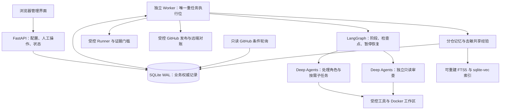
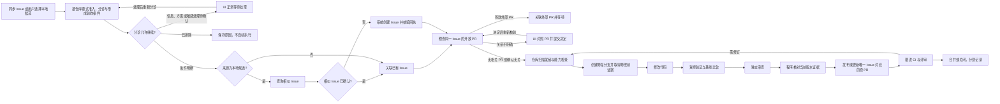

# GitHub Issue Agent Harness：完整设计基线

状态：功能、框架、核心流程、接入及自动补全 Q1—Q36 已逐项确认，[正式可行性分析与开发路线报告](feasibility-report.md)已完成。自动补全规则见[扫描自动补全](scan-recovery-proposal.md)。此文描述设计，不表示产品已经实现或通过集成验证。

2026-11-03 完成文档一致性复核；跨模块的状态、执行权、版本、预算及边界细节统一见[实施契约](implementation-contracts.md)。巡检频率采用后续用户调整：活跃约每 2 小时、空闲每天一次。

## 最终架构

一个代码仓库内的模块化单体，本机分别运行 API 和 Worker。Python + FastAPI 提供后端及控制接口，React + TypeScript + Vite 提供浏览器界面；浏览器关闭不终止后台服务。

| 部分 | 已确认选择与边界 |
| --- | --- |
| API／Worker | API 管配置、人工决定和状态；Worker 管长任务；以数据库持久队列交接 |
| Agent 底座 | LangGraph 承载明确阶段与恢复，Deep Agents 承载任务内模型／工具循环；自行运行，不依赖托管 MDA |
| 角色 | 处理＋独立审查两类核心角色；扫描、调查、规划、复现和实现为不同任务模式，按需委派子任务 |
| 数据 | SQLite WAL 为本地默认，保留 PostgreSQL 适配；业务状态与运行检查点分层 |
| 环境 | Docker Linux 为默认，Windows 使用 WSL2 后端；原生执行显式启用，用户日常目录保持独立 |
| 并发 | 扫描、修复、PR 返修共用唯一重任务执行位；模型分诊、方案和记忆提炼也由 Worker 串行调度，不在巡检旁路调用模型；子任务默认串行，同一工作区单写 |
| 权限 | 角色按当前运行授予工具，独立审查只读；供应商与 GitHub 写凭证留宿主受控模块 |
| 模型 | 各角色选择供应商与模型，支持指定参考项目的手工／JSON 导入方式和两类模型 API；配置快照及能力准入 |
| 记忆 | 业务记录为事实源，分仓完整上下文＋跨仓去敏经验；本地 CPU embedding、混合检索和可重建索引 |
| GitHub | 用户 token 配置与本地条件轮询；按仓库和第三方 Fork 路径适配权限；发布与同步职责分开 |

## 对象和控制权

- 仓库、扫描批次、业务任务、任务运行和 PR 分别管理状态，业务数据库是对外权威。
- 所有人工介入节点均有 UI 处理入口、证据与操作结果，待人工事项与相关详情页互通；暂停时仍可管理，决定提交后重新核验，不以确认代替验收或显式恢复。操作映射见[实施契约 §3](implementation-contracts.md#人工处理入口与操作)。
- LangGraph 检查点记录运行内部位置和上下文，不单独宣告扫描完成、验收通过或 PR 已创建。
- Agent 通过 Harness 的结构化任务与结果协议交接，携带代码版本、配置快照和产物引用。审查由工作流必经调用，不由开发角色决定是否跳过。
- 验收规则、Runner 与最终证据记录由程序控制；Agent 可以修改代码和新增测试，但不能削弱验收条件来换取通过。
- 默认一个 API 进程管理只读同步循环，一个 Worker 负责模型及重任务；只读同步可以更新本地记录，不执行模型分诊或仓库命令。诊断、索引及人工恢复边界见实施契约。

## 导入与扫描

1. 导入公共／私有仓库，核验权限和贡献路径，准备独立副本并固定代码版本。
2. 程序枚举自有源码、测试、配置、CI 和依赖声明，生成模块清单与排除记录。
3. 建立环境及适用检查基线，核验扫描角色能力，逐模块串行深度审查并记录候选证据与覆盖账本。
4. 程序确认全部约定模块和证据齐全后，仓库才可进入自动修复；存在可恢复缺口时先在原预算和授权内自动补全，无法恢复或耗尽上限才保持阻塞。
5. 同版本可断点续扫；目标分支变化使旧结论对新版本过期，建立新批次补扫受影响范围，无法可靠界定影响时全仓重扫。每次重新导入仍完整扫描；不能修改旧批次 SHA 后保留其完成标签。

构建产物、下载的第三方源码及二进制不逐文件扫描，但记录排除项并检查第三方依赖的声明、版本与使用方式。发现的问题先作为本地候选；用户选择后由系统查询相似 Issue，关联同一问题的已有 Issue，未发现相似项时自动创建 Issue。Issue 确认和外部 PR 检查通过后才可建修复分支。

所有修复入口及发布前均受扫描就绪门槛约束，本地候选也不能绕过。就绪同时绑定目标配置、导入代次、代码版本和扫描策略；重新导入即使 SHA 不变也撤销旧就绪，完成本次全扫后才放行。PR 未合并修改由任务验证覆盖。需要补扫时，修复任务保存现场并释放执行位；依赖完成后唤醒，补扫保留预算归属。具体规则见实施契约 §3—4。

## Issue 修复与 PR 跟进

- 已有与新增 Issue 按手动选择／标签准入／全部合格 Bug 的仓库模式分诊，自有或有维护权限仓库默认全部合格 Bug，第三方公共仓库默认标签准入；功能请求与大规模重构先确认方案。六类分诊、占用／敏感排除、评论默认关闭、严重程度／老化及重新分诊规则见[实施契约 §3](implementation-contracts.md#issue-准入与分诊)。
- 无测试时补充在修改前失败、修改后通过的回归测试；失败原因必须能证明目标问题，不能以环境失败冒充复现。
- 本地候选须先通过准入／敏感检查，再关联已有 GitHub Issue 或由系统创建 Issue；建分支前及发布前检查开放 PR、标签和 assignee 等最新条件。同一问题的外部 PR 关联等待，确认无关则继续，仅关系不明由用户决定。Issue 与受管 PR 一一对应、返修更新原 PR、关闭后保留绑定，外部 PR 事实作为观测保存；见[实施契约 §8](implementation-contracts.md#issue-与-pr-一一对应)。
- 原有失败检查只有在证明与修改无关且未恶化时才不阻塞；新增、相关或无法归因的失败阻塞 PR。
- 可修复的问题在预算内返回修改阶段；证据不足、环境不可用、必需能力缺失或预算耗尽触发阻塞。
- 验收证据绑定实际代码内容和冻结的候选提交／树，不能只记录 `HEAD` 而遗漏脏工作区；修改后重新验证与审查，发布前核对 base／head、任务输入和证据，取得有效证据后才允许创建或更新 PR。
- 功能和纯重构的批准方案必须包含任务验收规范；Bug 保持修改前失败／修改后通过，纯重构证明结构目标及行为保持，不编造原本不存在的 Bug。具体证据要求见实施契约。
- 提交前验收与创建后 PR 专属 CI 分开。仅能在 PR 环境验证且无其他有效提交前修复证据的任务保持阻塞。
- PR 创建后继续跟进 CI／评审，必要修订重新排队和验证；合并由用户或仓库规则执行，关闭未合并不记作已解决。
- 返修关联同一主任务和 PR，使用最新分支版本，继承累计预算；意见有歧义或越过已批准范围则正常等待确认。CI／评审必须绑定实际提交。

返修的原问题复现以未修复上游 base 为失败侧，不强求旧 PR head 再失败；完整 PR 相对当前 base 的回归与独审仍必需。反馈按运行领取的修订消费，新意见保留；必要 CI 按来源、策略与最新适用尝试汇总。细则见实施契约 §5、§7—8。

## 暂停、恢复和远程写入

- 权限、环境、验证、必需模型能力、持续错误、无进展／振荡或已耗尽预算等执行障碍导致全局暂停；其他仓库重任务也等待，用户处理后明确恢复。
- 程序按实际覆盖、实验与验证证据检测进展，记录跨运行保留；复杂任务有进展但额度预计不足时，可耗尽前正常等待用户批准有限追加，累计消耗和检测历史不清零。独立运行安全上限继续有效，具体规则见[无进展检测](implementation-contracts.md#无进展检测)与[预算续期](implementation-contracts.md#进度驱动的预算续期)。
- 扫描可恢复缺口在进入阻塞前先自动补扫、拆分重试、重跑真实检查或重建受管环境；不自行增加预算、不降低门槛、不改变供应商，已阻塞任务不自行解除暂停。
- 等待方案批准或 PR 评审属于正常等待，释放重任务执行位；暂停期间只读 GitHub 巡查与状态同步继续。
- 数据库持久队列用短事务、租约和心跳维护唯一执行权。Worker 崩溃或宿主重启发现未结束运行时，先核对业务记录、检查点、代码、产物及旧命令／容器，再由用户明确恢复。
- 租约到期不等于旧命令已停止，确认前不能盲目复用工作区。
- 执行代次隔离旧 Worker；暂停、取消或正常等待只有在旧写命令结束／隔离后才释放执行权。正常等待的任务及图中断不自动被判为崩溃。
- GitHub 写入保存操作意图与结果，回执丢失时先核对远端；结果未知保持阻塞，不盲目重发，也不声称 checkpoint 能提供远程恰好一次保证。

## 模型和记忆的有效性

- 供应商保存／导入不自动调用模型。基础连接测试不等于角色具备工具调用与结构化结果能力，任务前按实际需要核验，并记录配置版本。
- 运行中保持配置快照，瞬时错误有限重试；默认不跨供应商自动切换，用户调整配置并明确恢复。
- 通过验证与独立审查后自动提炼经验，失败尝试单独标记；用户可查看、纠错、禁用与删除。
- 已验证经验与 PR 被接受／合并分别记录；CI 或评审证据推翻修复结论时，关联成功经验停止复用并待复核，返修后更新。
- 检索先满足仓库／共享范围和可用状态，组合结构、关键词和语义候选；命中后回源核对版本。索引和 embedding 配置变化须可重建。
- 语义功能未就绪时明确降级到关键词／结构检索，不伪称语义可用，也不降低 PR 验收门槛。
- 跨仓库只共享去敏提炼经验，复用后仍需在当前仓库独立验证。

## 正式报告的论证与实验边界

业务与技术路线已经明确；正式报告已对比相关开源项目及替代路线的实现和许可证，说明所选方案为何适用、哪些能力需要自建，以及存在的工程限制。

具体组件版本、embedding 型号、检索参数、巡查间隔和预算默认值由报告依据约束推荐，并列出发布前实验；不能把未经实测的配置写成已兼容或已提效。若源码核查或实验方案发现与硬约束冲突，应明确指出并重新讨论相关决定。

实施阶段必须从本最终架构拆分，阶段安排不改变最终范围。验收实验至少覆盖：扫描完整性与续扫、修改前后证明、验收弱化检测、全局串行与暂停、崩溃及远端写入对账、多供应商交接、中文／代码检索、删除一致性和记忆 A/B 效果。

## 详细依据

- [可行性分析与开发路线](feasibility-report.md)
- [相关项目实现对比](research/project-comparison.md)
- [实施契约](implementation-contracts.md)
- [文档复核记录](document-review.md)
- [功能基线](requirements-baseline.md)
- [逐轮决定](design-discovery.md)
- [架构职责](architecture-discussion.md)
- [状态与流程](workflow-design.md)
- [交接、记忆与接入](integration-discussion.md)
- [领域术语](../GLOSSARY.md)
- [架构决策记录](adr/)
- [只读源码与文档调查](research/)
