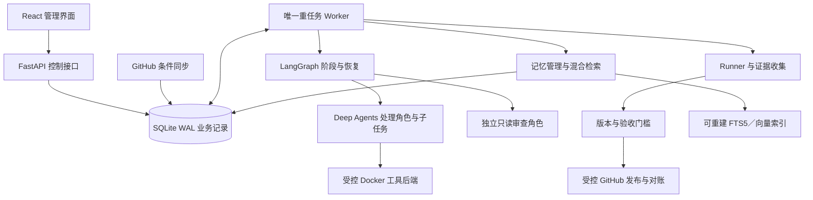

# GitHub Issue Agent Harness：可行性分析与开发路线

日期：2026-11-02
适用范围：已逐项确认的 Q1—Q36，见[完整设计基线](design-baseline.md)。

2026-11-03 文档一致性修订：巡检按用户后续调整为活跃约每 2 小时、空闲每天一次；实现中的状态、版本、预算、调度与边界细则见[实施契约](implementation-contracts.md)，已处理问题见[复核记录](document-review.md)。调研提交和调查日期仍按原记录，不表示再次联网核查。

本报告基于公开项目固定提交、官方文档，以及用户指定私有项目中获准查看的供应商配置文档与前端实现。没有运行这些项目、模型兼容实验或真实仓库修复基准；下文的工程判断、工作量和实验目标均不作为实测结果。

## 1. 结论与推荐

**项目有条件可行。推荐在 LangGraph＋Deep Agents 上构建本地模块化单体，复用成熟执行原语，自建仓库业务控制层。** Python／FastAPI API 与独立 Worker、React／TypeScript／Vite、SQLite WAL、Docker／WSL2、本地混合记忆检索，与当前目标一致。

可行性的前提不是模型一定能解决全部 Issue，而是：系统可以明确记录处理范围、取得修复前后证据、独立审查、拒绝无证据发布，并在无法恢复时可靠暂停。无法复现、环境缺失、权限不足或预算耗尽的任务，允许以阻塞结果结束本次自动执行。

真正需要投入的核心是**覆盖账本、受控验证、状态一致性与恢复、GitHub 写入对账、记忆有效性**。模型循环和子 Agent 工具可复用，不能把“模型说完成了”作为产品完成条件。

不建议直接 Fork 一个平台后假定全部需求已经具备，也不建议同时接入多个完整 Agent 平台。OpenHands SDK 保留为执行适配的备选；PR-Agent、Kodus、gh-aw 等主要用于借鉴具体设计。

## 2. 需求逐项可行性

| 需求 | 判断 | 成立条件与限制 |
| --- | --- | --- |
| 已有／新增 Issue 自动修复并提交 PR | 有条件可行 | 可复现问题、可用环境、明确验收；不能保证所有 Issue 自动完成 |
| 每次导入完整全仓深度扫描 | 可实现约定覆盖 | 程序清单、版本、模块产物与覆盖核验；完成扫描不能证明已发现全部 Bug |
| 缺口自动补全 | 可实现受控闭环 | 原预算和授权内补扫、拆分重试、重跑真实检查或重建受管环境；不可恢复后暂停 |
| 本地多仓、统一串行 | 工程上可行 | 数据库队列、唯一执行位、租约、心跳及异常对账；API 与只读同步独立 |
| 多供应商、按角色选择模型 | 协议级可行，需兼容实验 | 实际网关必须支持对应工具与结果协议；基础连接成功不能替代能力准入 |
| 分仓和跨仓记忆 | 存储与检索可行，收益待测 | 去敏、权限过滤、版本失效、可重建索引；用对照实验验证是否提效 |
| 确保解决后才 PR | 可保证执行约定的证据门槛 | 程序控制验收和发布；不能证明任意程序的绝对正确性 |
| PR 提交后持续跟进 | 可行，依赖上游条件 | CI／评审与实际 SHA 关联；第三方授权、未触发检查与未知状态不能当成成功 |

“覆盖完整”“验证通过”“PR 创建”“PR 合并”是不同结果，必须分别记录。

## 3. 相关项目的实现方式与复用价值

项目均固定到本次 GitHub REST 核查的提交；旧 `qodo-ai/pr-agent` 实际重定向到 `The-PR-Agent/pr-agent`，不重复计算。详细模块、流程、源码与许可依据见[项目实现对比](research/project-comparison.md)，原始版本元数据见[仓库快照](research/repository-snapshots.json)。

| 项目 | 架构／主要流程 | 对本项目的价值 | 作为完整底座的缺口 |
| --- | --- | --- | --- |
| Deep Agents＋LangGraph | Agent 工具循环＋可持久化图；任务、工具、子 Agent、检查点、中断恢复 | **已选执行底座**，便于显式阶段及独立角色 | 无本产品的全局队列、覆盖账本、验收协议和发布对账 |
| Open SWE | Web／FastAPI／PostgreSQL 应用＋MDA；Issue 提及→会话→修改→检查→push／PR | 借鉴长任务、PR 关联与反馈续作 | 当前应用强制依赖 MDA；独立 reviewer 可用但并非统一发布必经门槛 |
| OpenHands＋Automation＋SDK | 当前主仓为 Canvas；Automation 触发→持久入队→分发→SDK／Server 执行→回调／看门狗 | **重要备选与调度参考**；源码支持本地 Server＋SQLite | 通用自动化可并发；单自动化停用不等于跨仓全局暂停，修复验收需另建 |
| PR-Agent | 事件／命令路由到审查、描述、建议工具；获取 Diff→组织上下文→模型→回写 | 借鉴 Diff 上下文、指令协议和审查输出 | PR 分析工具集不等于完整 Issue 修复与执行恢复系统 |
| Kodus | NestJS API／Webhook／Worker＋审查流水线；普通 generalist，deep 模式多专家并行 | 借鉴专业审查、结果校验与去重 | PostgreSQL／pgvector＋MongoDB 部署较重；AGPL 与专有企业代码混合，不能整体搬用 |
| mini-SWE-agent | Agent／Model／Environment 的简洁命令循环 | 理解执行器及轨迹，适合作为简单基准 | 缺服务控制层、队列、GitHub 生命周期和独立证据门槛 |
| gh-aw | Markdown 编译为 Actions，Agent 执行与受控写入分开 | 借鉴声明式流程与程序化发布边界 | Actions 为主要运行形态，与本地持久状态及工作区不同 |
| Claude Code Action | GitHub 事件准备上下文→运行 Claude Code→更新结果 | 借鉴 GitHub 交互与事件上下文 | 主要依赖 Action／Claude Code 执行路径，不能直接替代本地多供应商 API Harness |
| Probot | GitHub App Webhook 分发与认证客户端 | 借鉴事件接入与认证封装 | 是 Node.js 事件框架，不能提供 Agent 执行、验证或恢复能力 |

本次核查的 Deep Agents、LangGraph、Open SWE、OpenHands 相关仓库、PR-Agent、mini-SWE-agent、gh-aw、Claude Code Action 的自有源码许可为 MIT，Probot 为 ISC；第三方依赖及服务条款分别适用。Kodus 虽然元数据为 `NOASSERTION`，正文已明确非企业源码使用 AGPL-3.0，`.ee.` 文件及 `ee/` 代码适用专有企业许可，审查流水线装配也涉及企业文件。本项目主要借鉴其设计，不整体复制；详见[固定源码及许可分析](research/project-comparison.md#10-kodus分阶段审查流水线)。

### 3.1 当前选定组件的版本事实

| 组件 | 固定提交 | 包声明 | 解释 |
| --- | --- | --- | --- |
| Deep Agents | `311ed7fb0e496b93ca56fb0b8e46ed0e5355600f` | 0.7.32，Python ≥3.11、<4 | 接受 checkpointer、Store、backend、模型和子 Agent；包声明仍带 Beta 分类 |
| LangGraph | `ee3c043bddcc514012885167dd5916b15d6e4731` | 1.2.19，Python ≥3.10 | 提供图执行与持久化接口，不替应用实现跨仓业务控制 |
| SQLite checkpoint 包 | 同上 | 3.1.3 | 同仓库已有 SQLite Store；不应从零重写其全部能力 |
| OpenHands SDK 备选 | `98849457621881ae2414719b82b8bc1cf535b4ab` | 1.59.0，Python ≥3.12 | 编码 Agent、会话、工具及工作区可复用 |

依据：[Deep Agents 包声明](https://github.com/langchain-ai/deepagents/blob/311ed7fb0e496b93ca56fb0b8e46ed0e5355600f/libs/deepagents/pyproject.toml)、[执行入口](https://github.com/langchain-ai/deepagents/blob/311ed7fb0e496b93ca56fb0b8e46ed0e5355600f/libs/deepagents/deepagents/graph.py)、[LangGraph 包声明](https://github.com/langchain-ai/langgraph/blob/ee3c043bddcc514012885167dd5916b15d6e4731/libs/langgraph/pyproject.toml)、[SQLite 包](https://github.com/langchain-ai/langgraph/blob/ee3c043bddcc514012885167dd5916b15d6e4731/libs/checkpoint-sqlite/pyproject.toml)、[OpenHands SDK 包](https://github.com/OpenHands/software-agent-sdk/blob/98849457621881ae2414719b82b8bc1cf535b4ab/openhands-sdk/pyproject.toml)。

这些是源码调查点，不是已经通过依赖解析和集成测试的锁文件。建议开发采用统一 Python 3.12 环境，第一阶段锁定经实验通过的完整依赖集合。仅有 Deep Agents 不意味着所有供应商适配包已安装；Chat Completions／Responses 的模型适配依赖需要显式配置。

## 4. 开发路线选择

| 路线 | 优点 | 主要成本 | 判断 |
| --- | --- | --- | --- |
| LangGraph＋Deep Agents，自建业务控制层 | 与暂停恢复、显式阶段、多角色和本地状态需求匹配；MIT 库可嵌入 | 需要实现业务协议、Runner、覆盖、调度和发布；控制框架升级影响 | **首选**，与已确认设计一致 |
| OpenHands SDK＋宿主业务工作流 | 编码工具和工作区抽象完整，模型适配面较广 | 仍需补全部业务控制；会话事件与工作流恢复的映射需设计 | 若首选工具适配或依赖成本过高，可评估备选 |
| Fork Open SWE／完整 OpenHands 应用 | 已有较多产品界面和工程集成 | 上游部署结构、身份模型、运行时及升级面较大；需核对本地硬约束 | 适合愿意接受现有产品形态时，不作为本项目默认路线 |
| 以 Actions 工具为中心组合 | GitHub 触发、日志和 CI 集成方便 | 本地多仓控制、长期工作区和跨任务记忆需重新搭建 | 适合作为云端补充或参考 |
| 完全自建模型循环 | 最大控制力，可参考 mini-SWE-agent | 自行承担上下文、工具、子任务、恢复与模型变化维护 | 当前投入收益不优 |

路线选择是针对这些约束的工程判断，不是对各项目代码质量的排名。复用顺序建议为：**框架库原语 → 小范围适配 → 借鉴业务设计**。不把多个平台的数据库、调度器和身份体系整体叠加。

## 5. 最终架构与职责

### 5.1 需要自建的业务内核

| 模块 | 关键责任 |
| --- | --- |
| 仓库与扫描 | 固定版本、清单、模块分组、排除记录、覆盖账本、版本失效与补扫 |
| 任务与全局控制 | 持久队列、唯一执行位、租约、心跳、正常等待、全局阻塞和人工恢复 |
| 运行与产物 | 配置快照、检查点关联、工具事件、不可混淆的代码／环境／证据版本 |
| 受控验证 | 修改前后证明、原有失败基线、独立审查、验收弱化检测和证据包 |
| 模型与角色 | 供应商导入、模型适配、能力准入、角色工具和上下文、费用／调用量记录 |
| GitHub 发布 | 权限与贡献路径、稳定分支／操作标识、远端对账、CI／评审关联 |
| 记忆 | 原始事实源、提炼、去敏、检索、删除／禁用、失效与效果评估 |

仓库、扫描批次、任务、运行和 PR 分开保存状态。框架 checkpoint 仅记录执行进度；不能将“节点执行过”投影成“验收通过”。建议用持久阶段意图、结果与产物引用处理业务记录和 checkpoint 非原子提交的窗口。

默认 API 进程管理独立的只读同步循环，Worker 是唯一模型／重任务执行者。模型分诊、方案及记忆提炼也进入串行控制；只读巡检更新本地记录和待分析信号，不在旁路调用模型。所有修复入口都受扫描就绪约束；需要前置补扫的修复让出执行位，避免互相等待。明确的诊断模式可在暂停时帮助排障，但不能发布或自行恢复。

### 5.2 执行和凭证边界

模型 API 调用和 GitHub 写凭证由宿主受控模块持有。Agent 的文件与命令工具经统一执行后端作用于任务工作区；独立审查只读，不获得发布工具。

业务数据库和最终验收记录不作为 Agent 可写卷暴露给任务容器。Runner 独立收集真实命令、结果和产物；新增测试可修改，但其有效性和验收规则变化必须审查。

Deep Agents 会组装文件中间件和通用子 Agent，集成时必须核对最终工具表、权限配置及 backend 的实际能力；只传入一个工具列表或写“只读”提示词不足以证明审查角色只读。本项目使用本地／同步子任务路径；固定源码中异步子 Agent 路径涉及 LangSmith 部署，不应误选为纯本地默认方案。[固定执行组装源码](https://github.com/langchain-ai/deepagents/blob/311ed7fb0e496b93ca56fb0b8e46ed0e5355600f/libs/deepagents/deepagents/graph.py)。

Windows／WSL2 需要验证工作区卷、Git 权限与文件语义、容器重建和受控发布之间的交接。API／Worker 位于同一操作系统侧并使用本地 SQLite 路径，不能跨 Windows／WSL 文件共享访问同一 WAL。任务容器不持有数据库、凭据或 Docker socket；发布器持写凭证时不执行仓库脚本、hooks 或过滤器。具体卷和发布物化方案列入 P0，必须核对容器被测内容与发布 Git 树一致。

### 5.3 Agent 如何交接

处理和审查使用独立会话，可选不同供应商。工作流给处理角色结构化任务，至少包含任务／运行标识、仓库与版本、验收条件、可用工具、预算及记忆引用；处理结果返回修改摘要、复现／测试建议、产物引用和未决问题。Runner 执行并保存证据后，工作流再把 Diff、验收条件和证据引用交给只读审查角色，由其返回问题位置、严重度及审查结论。

交接由 Harness 持久化和校验，不依赖 Agent 彼此自由聊天。需要返修时，由工作流把具体发现重新派给处理角色；证据与审查均通过后才调用发布器。审查角色不能改文件、修改验收记录或自行发布 PR。子任务使用相同协议，默认串行，不新增固定常驻角色。

实现时建议保留 `Repository`、`ScanBatch`、`CoverageItem`、`Task`、`Run`、`Artifact`、`Validation`、`Review`、`PublishOperation`、`PullRequest`、`Memory` 和 `GlobalControl` 等业务对象；每项证据引用具体运行、代码及环境版本。业务事务和图 checkpoint 分开管理，API 展示以业务表为准。术语及状态含义见[术语表](../GLOSSARY.md)与[详细流程](workflow-design.md)。

## 6. 两个主要闭环

### 6.1 导入扫描与自动补全

固定版本 → 程序清单／排除项 → 环境与检查基线 → 模型角色能力准入 → 逐模块审查 → 覆盖和证据核验。

可恢复缺口进入**受控自动补全**：补扫、拆小输入、有限重试、重跑真实检查或重建受管环境；每次补全后重新核验。不能增加原预算、放宽范围或伪造通过，不能扫描时顺便修改业务缺陷。无法恢复或耗尽上限才进入全局阻塞；已阻塞和异常中断任务仍由用户处理后恢复。

覆盖证明应绑定代码版本、文件／模块标识、输入范围及产物。模型说“全部看过”或只枚举到文件名不构成完整覆盖。目标分支变化后补扫影响范围，无法可靠判定时全仓重扫。

扫描批次固定 SHA，不在版本变化后改写旧批次；新批次逐项记录新检查或明确的覆盖复用依据。PR 未合并修改由任务验证覆盖；目标分支变化后才需要重新建立仓库就绪。超大文件、自有子模块、LFS 指针和符号链接不能被静默视为已审查。扫描依赖准备和检查结果不得通过改写业务源码／锁文件来取得通过。

### 6.2 修复与交付

Issue 分诊 → 验收条件 → 领取执行位 → 检索经验与能力检查 → 修改前复现 → 修改 → 修改后检查／基线比较 → 独立审查 → 当前版本证据门槛 → PR → CI／评审反馈。

证据包至少关联：问题及验收条件、base／head 版本、复现探针或测试、原有检查基线、实际命令和退出结果、环境／配置快照、审查发现及结论、产物摘要。修复前测试不存在时，需要将同一有效回归测试用于未修复代码，不能把测试导入错误或缺依赖当作 Bug 已复现。

最终候选必须冻结，核对实际内容而非仅 `HEAD`；未提交修改和未跟踪测试不能被遗漏。源码或验收规范变化后重验及重审，发布提交与被测树一致。Bug 保持修改前失败／修改后通过；已批准功能和纯重构在方案中规定能力目标或结构目标及行为保持证据，不编造修改前 Bug，也不能通过改名降低 Bug 门槛。

验证失败与审查发现可在预算内返回修复；无法完成验证才阻塞。PR 正常等待释放执行位，返修重新排队；合并和关闭未合并分别记录，验证状态与交付状态也分别记录。

评审请求修改关联原任务、原 PR 和对应提交；范围内修改自动返修，歧义或越过方案范围先等待确认。分支外部更新不能盲目覆盖。正常等待、图中断与真正异常遗留运行分开，避免每次重启都因有开放 PR 而全局阻塞。

PR 专属 CI 不能在 PR 不存在时提前取到。提交前的本地／可触发远程检查与创建后 CI 分开；目标问题若只能依赖 PR 环境证明，且无其他有效提交前证据，保持阻塞。依据：[GitHub PR 事件与合并 ref](https://docs.github.com/en/actions/reference/workflows-and-actions/events-that-trigger-workflows#pull_request)。

## 7. 供应商与记忆的落地方式

### 7.1 供应商适配

沿用指定参考项目的交互和字段：手工／JSON 文件／文本导入，供应商名称、地址、接口、密钥、模型列表和推理强度；整批校验保存，导入不发模型请求。按处理、审查及子任务角色解析具体模型，运行保持快照。

该交互已核对用户指定私有仓库的固定版本[供应商文档](https://github.com/Gwex323/repo/blob/039494d933fae95e74895ffb67af208d1e3b9cd9/docs/model-providers.md)与前端源码；此处只据此确定配置行为，不继承其角色数量或平台架构。

基础连接测试、模型列表拉取与实际角色能力准入分开。准入需覆盖工具调用、结果解析及实际接口行为，按供应商／模型／接口／配置版本缓存有效结果；不因换一个地址仍返回文本就判定兼容。

瞬时错误有限重试；必需能力不兼容、持续失败或预算／额度耗尽时全局暂停，默认不自动切换供应商。密钥安全存储、错误脱敏和配置变更对运行的影响都纳入测试。

### 7.2 GitHub 同步与发布

以用户令牌和条件轮询接入，每个仓库保存查询条件、分页验证器及同步进度，按 Issue／PR 稳定标识去重，并定期补偿对账。首轮导入同步已有 Issue，后续同步新增、修改和 PR 反馈；单页 304 不能当作全仓无变化。初始建议为活跃仓库约每 2 小时巡检一次、空闲仓库每天一次；频率按仓库配置，加入抖动、限流和退避，并遵循 GitHub 返回的限制。默认活跃指有未结束任务／受管 PR，或最近 7 天观测到 Issue／PR 更新，7 天是可配置的工程初值。PR／CI／评审跟进默认也用该仓库频率；首次、人工及发布前必要读取不等待定时器。

一次查询的全部必要页面落库后才推进水位，失败保留上次成功进度。Issues 列表中的 PR 分流，其他端点分别处理评论／评审／检查，不能复用 Issue 的 `since` 假设。临时只读同步失败记录健康状态并退避；任务必需权限或最新状态无法核验才转执行阻塞。Issue 被关闭或实质编辑后，旧快照不继续直接发布。

有维护权限的仓库从受管修复分支发 PR；第三方公共仓库走用户 Fork。令牌预检必须覆盖实际路径，不能因能写自己的 Fork 就推断能向上游开 PR；fine-grained PAT 与 classic PAT 的适用范围按官方限制选择。发布器记录操作意图和远端结果，创建回执丢失先查询核对，结果不明时阻塞。

用户选择本地扫描候选后，系统先完整查询目标仓库中的相似 Issue；明确重复时关联已有 Issue，确认没有相似项后由宿主受控发布适配器创建 Issue。写入结果核验前不得建修复分支；请求结果未知时先对账。创建分支前及发布前检查同一 Issue 的开放 PR，明确等效的外部 PR 关联等待，关系不清时等待用户；外部 PR 合并后核验证据确认问题已解决，关闭未合并时重新判断是否恢复。

PR 描述采用用户指定的“概述、变更内容、设计方案／说明、验证／验收、review 记录”结构；必须关联已确认的 GitHub Issue 编号和本地候选来源，列明可验证事实、已有失败和后续 CI 状态。创建 PR 不等于自动合并，也不预先宣称 PR 专属检查通过。接入依据见[GitHub 集成核查](research/github-integration-facts.md)。

### 7.3 记忆索引与复用

业务表保存记忆正文、来源、仓库／共享范围、内容版本、验证状态及有效性；FTS 和向量是可重建派生索引。可复用 LangGraph 已有 SQLite Store 能力，但需要补关键词融合、业务同步和权限回源检查。

检索流程建议为：任务特征 → 仓库／共享范围与可用状态过滤 → 关键词及语义候选 → 融合排序 → 回源核验 → 有限上下文注入。避免全局 top-k 后才过滤而漏掉本仓相关记录。

本地 CPU embedding 无需额外远程服务，但要管理模型资产、许可证、维度、编码规则和缓存。中文与代码标识符召回必须单独测量；不能假定默认 FTS tokenizer 已具备完整中文分词。具体编码模型通过许可证及召回实验选择。依据见[记忆组件核查](research/memory-retrieval-facts.md)。

语义未就绪时明确降级，删除／禁用及时影响新检索；换模型重建索引，不混用旧向量。失败经验不得被当成已验证方案，后续证据推翻经验时应失效或纠错。

已验证修复与 PR 接受／合并分别记录。评审或 CI 证据推翻修复结论时，关联成功记忆待复核并停止成功复用，返修通过后更新；纯格式意见不自动推翻原验证。编辑语义内容不继承旧验证标签，删除／禁用先更新事实源，再清理索引，恢复 checkpoint 时重新校验记忆注入。原任务审计记录与记忆删除的留存范围分别管理。

## 8. 主要工程风险与处理

| 风险／难点 | 影响 | 建议处理 |
| --- | --- | --- |
| 全仓扫描成本随体量增长 | 导入长时间占用唯一执行位 | 内容分块、版本化清单、可恢复产物、预算可见；不减少约定覆盖 |
| Agent 自证完成或弱化测试 | 错误 PR 通过 | Runner 和证据边界独立、审查测试有效性、固定验收协议 |
| SQLite 双进程及索引写竞争 | 锁等待、状态滞后 | 短事务、受控重试、合理 checkpoint／索引频率及目标负载验收 |
| checkpoint 与外部操作不同步 | 重复 PR、重复命令或错误完成态 | 操作日志、远端核对、执行权与旧命令检查，未知时暂停 |
| 源代码和目标分支持续变化 | 证据过期、返修循环 | 绑定版本、提交前复核、补扫／重验与预算控制 |
| 多供应商协议差异 | 工具结果无法接续、角色不可用 | 真实网关能力矩阵、配置快照、明确错误，不静默切换 |
| 检索经验过期或误召回 | 放大错误修复方向 | 来源与版本、回源过滤、纠错／撤销，仍需当前仓库验证 |
| Windows、容器和 Git 文件语义 | 执行成功但无法可靠交付 | P0 验证真实宿主与工作区组合，不把 Linux 容器成功算作 Windows 全链路通过 |
| 第三方仓库权限和 CI 规则 | 无法 Fork／创建 PR／取得检查 | 按路径预检 token；未知结果、维护者批准和权限不足分别记录 |
| 同步分诊或补扫绕过调度 | 并行模型调用，或持有唯一执行位等待另一个任务 | 同步只写待分析信号，模型工作由 Worker 执行；前置扫描等待释放执行位 |
| 新运行／返修重置预算 | 无限重试及成本失控 | 按原任务累计，SDK 重试和子任务同样计数；等待不消耗有效执行时长 |
| 迁移／备份不一致 | 丢失 WAL、恢复后重复远程写入 | 单迁移者、一致性备份与归档清单，恢复后先对账 |
| 就绪标识只存 SHA | 同提交重导入／策略变化时绕过新扫描 | 导入代次、目标配置和策略修订共同绑定就绪，旧代次不得重新放行 |
| 同步和异步结果交错 | 新意见被旧运行清掉，旧状态覆盖新状态 | 信号按领取修订确认、冲突重读、结果条件更新；相同载荷不伪造活跃变化 |
| 提炼／摘要与记忆失效竞争 | 反证后重新写成成功，删除后摘要继续复用 | 来源反馈修订、共享派生状态关联、每次调用复核及必要时重建会话 |
| 多个持久化介质缺少协调 | 供应商出现半批配置，业务库与图状态备份错位 | 凭据暂存后一次激活；备份用覆盖全部相关写者的统一维护屏障 |

SQLite WAL 支持读写并发，但每库仍只有一个写者；LangGraph SQLite saver 的定位和引擎适用性须分别评估。[SQLite 官方说明](https://sqlite.org/wal.html)、[恢复与副作用边界](https://docs.langchain.com/oss/python/langgraph/interrupts)。

GitHub Create PR 使用分支名，没有通用幂等键或创建时的 expected-head-SHA 条件。稳定操作标识与创建前后核对能够抑制重复、发现偏差，不能声明跨系统“恰好一次”。[Create PR](https://docs.github.com/en/rest/pulls/pulls#create-a-pull-request)。

## 9. 必须通过的可行性实验

以下为实验设计，不是已运行结果。先做 P0，以免大量产品开发建立在未验证的适配假设上。

| 实验 | 输入／故障注入 | 通过条件 |
| --- | --- | --- |
| E1 模型协议 | 两个实际供应商、两角色、两种接口；工具与结果交接 | 所需协议可接续，记录实际角色／版本；不兼容时明确阻塞 |
| E2 全仓覆盖 | 已知文件和模块清单；漏一个模块或产物 | 覆盖不全不放行，自动补全在原预算内补齐，结果来自真实执行 |
| E3 恢复上限 | 截断、瞬时故障、缺依赖及不可恢复错误 | 可恢复者有限处理；耗尽上限全局暂停，不提高预算或削弱门槛 |
| E4 修复前后证明 | 无测试 Bug、有效回归测试、诱导性环境失败、已修复 PR 的格式返修 | 修复前后证据有效；环境失败不能冒充复现，原 Bug 不强求旧 PR head 再失败，完整 PR 仍重验 |
| E5 验收弱化 | 删除断言、增加忽略、修改命令 | 被独立审查／门槛拦截，发布接口未被调用 |
| E6 既有失败基线 | 已有无关失败和新增相关失败 | 只允许有证据的无关且未恶化失败；相关或无法归因者阻塞 |
| E7 唯一执行位 | API／Worker 双启动与多个仓库排队 | 同时活跃的重任务不超过 1，正常等待可释放，阻塞后不新领任务 |
| E8 崩溃与远端回执 | Worker 中断、旧命令仍运行、PR 已创建但 ACK 丢失 | 先暂停核对并人工恢复；指定注入场景中不盲目重发 PR |
| E9 代码版本漂移 | 通过后移动 base／head，同 SHA 重新导入，策略／目标配置变化，旧代次迟到 | 就绪核对完整身份，旧证据不能放行新要求，触发补扫／本次全扫或重验 |
| E10 记忆与索引 | 中文／代码、仓库过滤、禁用删除、换模型重建 | 新检索不返回失效内容，跨仓范围正确，重建可恢复 |
| E11 Windows 全链路 | 实际 Windows＋Docker／WSL2，含前端、API 会话／来源校验与 Git 交接 | 可安装、启停、续作和受控交付；数据库／卷行为正确，仓库命令不能调用宿主控制接口或读取凭据 |
| E12 记忆收益对照 | 固定任务集、模型配置和预算，有／无记忆对照 | 验证通过率不下降，报告时间、调用量和成本分布，不只报检索命中 |
| E13 分诊与调度依赖 | 暂停时新 Issue、共享扫描完成、等待方取消或预算授权撤销 | 同步只保存信号，模型先领取执行位；依赖完成原子唤醒，普通取消只解自身依赖，预算撤销安全停止并保留其他依赖 |
| E14 预算、进展与续期 | 子任务／SDK 重试／补扫／返修累计、重复无效动作／振荡、真实新覆盖／反证／子问题成果、长检查、复杂任务续期及重复／过期批准 | 固定归属不重置／重计／漏记；无进展及振荡提前停止、等待与真实进展不误判；耗尽前可正常等待有限续期、足额可继续、已耗尽仍暂停；无额不用模型估算、批准去重且只增加授权，不重置检测或解除其他阻塞 |
| E15 实际覆盖与代码内容 | 超大文件、自有子模块、LFS 实体／指针、脏工作区及不可交付引用 | 缺内容不放行，覆盖可核对，发布内容与被测内容一致；外部对象不可交付时不只推指针 |
| E16 记忆反馈与恢复 | CI 反证早于提炼落库、人工编辑／删除、共享派生、含记忆的压缩摘要 | 迟到结果不恢复失效成功，共享派生受来源约束，新请求不发送污染摘要，必要时重建会话 |
| E17 分页及对象生命周期 | 分页断网、运行中新增意见、乱序读取、人工排除、关闭／重开和 CI 重跑 | 水位不跨缺页，新信号不丢失，排除不被自动撤销，无重复修复，CI 按必要策略及适用尝试汇总 |
| E18 正常等待与排障 | PR 等待时重启；阻塞后测试新配置；旧 Worker 迟到结果 | 正常等待不误报崩溃，有界诊断不恢复队列，旧代次结果不能覆盖 |
| E19 功能与重构验收 | 获批功能、纯重构和伪装重构的 Bug | 验收类型和规范明确、相关证据有效，Bug 复现门槛不能绕过 |
| E20 备份迁移与存储故障 | 跨库备份与同步／索引／清理交错、旧备份后已有 PR、磁盘满、凭据与配置激活中断 | 屏障内备份一致且保留原暂停；恢复核对远端，导入无可用半批；P1 起不能持久化即停止执行和发布 |

记忆评测建议至少覆盖 30 个任务、同仓与跨仓相似问题，并进行时序或仓库隔离，避免把当前任务答案预先写入记忆。样本规模和改善阈值是实验方案，统计结果需报告波动；可将时间或调用量中位数降低 20% 作为待验证目标，不作为承诺。

## 10. 按最终架构分阶段实施

假设一名熟悉 Python、TypeScript、容器与 Agent 工程的开发者，复用成熟组件；下列为低精度工程估算，P0 前基线为**合计 16—24 人周**，P0 后重估为**合计 19—27 人周**，覆盖最终核心闭环及首批 Python／JS／TS 适配，不代表任意语言／专用设备适配均已包含，也不代表固定交付日期。已有可复用代码或多人协作也需重新估算。

| 阶段 | 对应最终架构 | 主要产物与退出条件 | 估算 |
| --- | --- | --- | --- |
| P0 可行性与契约 | 执行、环境、证据、恢复 | 依赖锁、角色／工具／证据和数据库迁移草案；E1、E7、E8、E11、E13、E18 的最小切片，副作用故障可先使用受控模拟端点 | 1—2 人周 |
| P1 Harness 内核 | API、Worker、数据、模型 | 唯一执行位、状态分层、事件产物、供应商及能力准入、诊断与暂停恢复；最小操作界面、仓库身份／读取同步接口及记忆事实源；E7、E14、E18 | 3—4 人周 |
| P2 导入与扫描 | 仓库、清单、覆盖、自补全 | 全仓扫描、覆盖门槛、断点续扫、版本失效与受控补全；E2、E3 通过 | 3—4 人周 |
| P3 修复与发布 | 处理、Runner、审查、门槛 | 修改前后证明、基线比较、独立审查、冻结候选、首条直接／Fork 发布路径与对账；E4—E6、E9、E15、E19 | 4—6 人周 |
| P4 持续跟进 | 同步、PR、CI／review | 完整分页轮询、Fork 场景、反馈返修、正常等待与终态；E13、E17 及真实测试仓库链路验收 | 2—3 人周 |
| P5 完整记忆 | 提炼、去敏、混合索引、评估 | 本地 embedding、检索融合、反馈失效、删除与重建；E10、E12、E16；无收益时定位原因 | 3—4 人周 |
| P6 本地产品化 | 启动器、环境、界面、运维 | 完整生产界面、API／Worker 生命周期、故障展示、预算日志、迁移备份；E11、E20 及关键回归 | 3—4 人周 |

P1 的接口、状态与产物必须兼容完整系统，不能到 P5 才重新设计记忆归属；P0 也不能以一个“能改文件”的 Demo 代替完整路线可行性。每阶段交付的是最终架构中的部分能力。

2026-11-04 P0 后重估：依据供应商适配修订、恢复／预算状态机、Windows→Linux 对象交接与 LFS／子模块缺口、编码资产真实语料评测成本，P1 上调 1 人周、P3 上调 1 人周、P5 上调 1 人周，合计 19—27 人周。该调整不改变范围，不承诺日期；证据与承接项见 [P0 汇总](development/p0-summary.md)。

P1 同时建立最小安全停止、持久化失败拒绝执行／发布及凭据激活对账，并验证 E20 对应切片；P6 的运维产品化不是这些保护开始生效的时间。最新任务分解见 [OpenSpec tasks](../openspec/changes/build-github-issue-agent-harness/tasks.md)。

## 11. 资源与预算建议

### 11.1 本机环境

建议以 Windows 11、Docker／WSL2、至少 16 GB 内存作为初始验收机配置，并用 32 GB 档位检验较大前端依赖、浏览器验收与本地 embedding；这是实验基准建议，不是已经测得的最低硬件要求。磁盘预算随镜像、工作区、依赖缓存和证据保留增长，应按实际样本测量。

数据库由同机宿主进程持有；工作区与缓存的卷位置、容器生命周期及发布路径须先做 P0。前端生产构建作为静态资源交付，Vite 开发服务器不作为后台生产运行依赖。

### 11.2 模型与扫描成本

不提供未核验的供应商价格。单次扫描或修复成本可按下式记录：

`模型成本 = Σ(输入 token × 输入单价 + 输出 token × 输出单价) / 1,000,000`

再分别记录重试、embedding 编码、本机工具时间和制品存储。扫描成本按模块累加；频繁重新导入必须完整扫描，会显著影响总成本和队列等待，不能用减少覆盖来隐藏。

可作为实验起点的初始授权：每模块自动恢复最多 2 次、扫描补全最多 2 轮、每个修复任务累计最多 3 轮修改—验证（含 PR 返修）；总有效执行时长／调用量另设上限。扫描任务 120 分钟、修复任务 90 分钟可用于首批样本，不是适用所有仓库的永久总额或实测承诺；等待排队／评审不计有效执行时长。拆分、新批次、新运行及返修不重置累计账本，能力检查、隐藏 SDK 重试及提炼均计数。复杂任务有真实进展时可在耗尽前申请用户批准的有限追加；耗尽前正常续期与超限全局阻塞分开，预算续期不自动放宽单步／阶段安全限制。无进展、振荡和预警初值及具体行为统一见[实施契约 §3](implementation-contracts.md#无进展检测)，须通过 E14 校准与验证；已阻塞不因加额自动恢复。

### 11.3 长期维护成本

需要持续维护的主要是模型网关协议矩阵、框架版本适配、测试与浏览器环境、GitHub 权限和 CI 差异、索引一致性及恢复演练。把框架隔离在运行适配接口后，并在升级时重跑 P0／关键回归，优于让业务对象直接依赖供应商或图内部状态。

## 12. 最终建议

按已确认的模块化单体与 LangGraph＋Deep Agents 路线推进，先完成能证明模型协议、Windows 工作区、数据库调度、证据控制和异常对账成立的 P0，再按最终架构实施。

优先投资顺序为：**业务状态与恢复 → 覆盖账本和自动补全 → 可核查修复证据 → 受控发布与反馈 → 记忆效果优化**。独立审查、版本绑定和阻塞规则属于交付门槛，不能在追求自动完成率时移除。

本报告的结论是“可以建设一个可靠拒绝无证据交付、逐步提升自动解决率的系统”。实际可自动解决的仓库和问题范围、吞吐量及记忆收益，须由上述实验取得数据。
