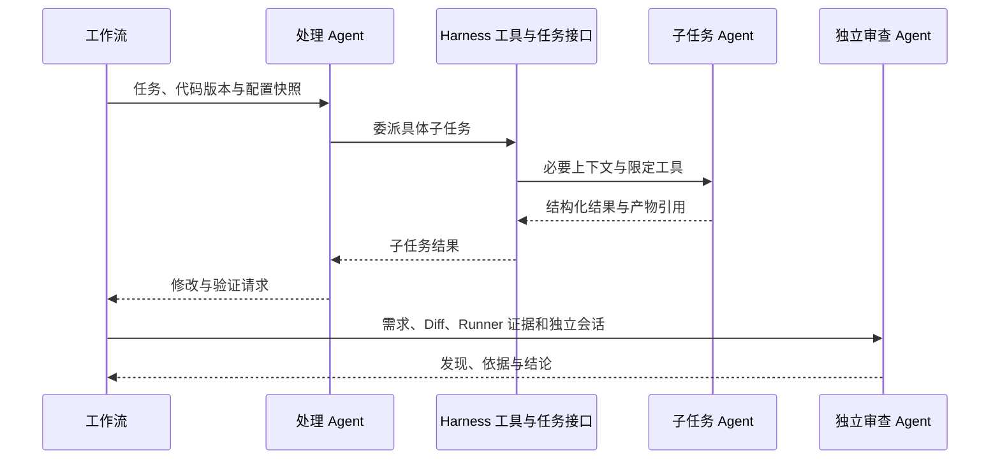

# Agent 交接、记忆与 GitHub 接入讨论

状态：Q31—Q35 已确认；本文记录已接受的接入规则，不代表已经实现或完成集成验证。事实依据见 `research/memory-retrieval-facts.md` 与 `research/github-integration-facts.md`。

2026-11-03 完成一致性复核，巡检频率已按用户后续调整；进程、版本、预算和恢复约束见[实施契约](implementation-contracts.md)。

## Q31 已确认：能力授权与结构化交接

### Agent 间交互

- 委派与结果经 Harness 转交，带任务／运行标识、角色、代码版本、配置快照、输入与产物引用。
- 调查、规划与复现等子任务默认串行执行；同一工作区只允许一个写入者，避免共享可变上下文产生冲突。
- 审查作为工作流必经阶段创建，不能仅由处理 Agent 自行决定是否调用；使用独立会话和只读能力。
- Agent 的完成消息只是待核验的结果，不直接改变验收或发布状态。
- 交接结果需通过结构校验并关联原任务，不能仅凭自由文本推进业务状态。模型分诊、方案、子任务和记忆提炼同样通过 Worker 唯一执行位串行执行。

### 权限与凭证

- 按角色和当前运行授予工具。处理 Agent 可在任务工作区编辑和运行命令，审查 Agent 只读代码及验证证据，可请求程序安排检查。
- 最终验证及独审前冻结候选内容并停止处理角色写入；审查没有通用可写终端，检查由 Runner 在隔离临时环境执行。仅在提示词声明只读不能构成权限隔离。
- API 供应商密钥由宿主模型适配层使用，GitHub 写凭证由受控发布程序使用，不放入 Agent 上下文或通用任务容器。
- Agent 文件工具、终端与检查器遵守同一工作区和运行授权；不能只靠提示词声明目录边界。
- Harness 控制验收规则与证据收集位置，Agent 不直接改写最终验收记录。
- 工具请求、结果和实际代码版本形成可追踪记录；仅授予当前任务需要的能力。

## Q32 已确认：分仓事实源与可重建混合索引

- 记忆原文、来源、版本、验证状态和禁用状态保存在业务数据库，作为事实源。
- 检索结合仓库范围／验证状态等结构过滤、FTS5 关键词和 sqlite-vec 语义候选，由应用做融合排序；可复用 LangGraph Store 的适配能力，不将 namespace 当作授权校验。
- 角色只取当前仓库记忆和允许共享的去敏经验，命中后回源核对内容版本与可用状态。
- 向量由本地 CPU embedding 产生，模型首次下载或导入需明确配置。此模型承担检索编码，Agent 推理仍使用已确认的模型 API。
- embedding 型号、版本、维度和编码规则参与索引版本；更换后重建，不混合旧向量。
- 索引是派生数据，可重建；禁用和删除及时影响新检索，不因索引同步滞后继续使用失效记录。
- 语义能力未就绪时明确显示降级并使用关键词／结构检索，不伪称语义检索成功，也不改变 PR 验收门槛。
- 需要验证中文、代码标识符、权限过滤、删除传播、重建和记忆 A/B 效果；不能仅凭引入向量组件声称解决速度已提升。
- 记忆记录保存症状、适用范围、根因、修复／失败方法及验证方法，关联任务、运行、提交与证据；大型代码／日志保留仓库归属的归档引用，不把整个仓库当作共享向量文档。
- 已验证修复与维护者接受／PR 合并分开记录。CI／评审证据推翻修复结论时，关联成功经验待复核并停止成功复用；纯格式意见或非代码原因关闭不直接推翻验证。
- 修改根因／方案等语义内容形成新版本，不能继承旧验证标签；禁用／删除先更新事实源，再清理索引。新检索与 checkpoint 恢复后的注入重新核对状态；任务原始审计产物与记忆删除有独立留存范围，详见实施契约。
- 记忆更新与待索引事件同事务保存，索引滞后依靠版本回查防止误用；语义索引切换须核验模型／维度／编码版本。
- 提炼与反馈复核提交时校验来源证据、反馈及记忆修订，迟到结果不能覆盖新反证或人工删除，共享派生项随来源失效。每次模型请求也复核记忆；压缩摘要无法剥离失效内容时重建会话，细则见实施契约 §9。

用户选择本地混合检索，未选择仅关键词或远程 embedding 的备选。最终 embedding 模型与版本依据许可证和召回实验选择，实验门槛在正式报告中列出。

## Q33 已确认：本地用户身份与条件轮询

- 本地版以 GitHub 用户 token 配置接入，安全保存，导入时核验仓库访问及贡献路径。
- 本人／组织仓库可在适用时使用 fine-grained PAT；第三方 Fork 贡献按 GitHub 现有限制采用具备相应权限的 classic PAT 等用户身份路径，不假定安装 GitHub App 即能写任意上游。
- 授权配置可按仓库选择；不把高权限 token 传给 Agent 或被测代码。
- 本地服务使用认证条件轮询，维护 endpoint／查询／分页的 validator，按对象标识去重，配合重叠更新时间窗口和周期复核；遵守限额与退避。
- 初始频率建议：活跃仓库约每 2 小时巡检一次，空闲仓库每天一次；按仓库配置并遵循 GitHub 限流。活跃默认指有未结束任务／受管 PR，或最近 7 天观测到 Issue／PR 更新，7 天阈值可配置；PR／CI／评审默认也用该仓库频率。首次、人工及发布前必要同步不等待定时器。
- 同步循环属于 API 进程，只读取 GitHub 并更新本地对象／待分析信号，不调用模型。Worker 分诊后才进入修复；全局暂停期间只读同步继续，分诊及模型提炼等待恢复。
- 各查询全部必要页面落库后才推进水位；Issues API 中的 PR 对象分流，评论／评审／检查使用各自端点。重复评审更新原任务，不重复创建修复或 PR；临时只读同步失败记录健康状态并退避，任务必需权限／状态无法核验时才作为执行障碍处理。
- 对象与信号按修订提交，运行只确认领取的集合，新意见不被旧运行清空；迟到读取不回滚新状态，相同载荷不刷新最近变化时间。具体冲突与去重规则见实施契约 §7。
- 原生同步与内部发布接口分开。同步用于读 Issue／PR／CI／评审，发布须经证据门槛和操作对账。
- GitHub App 或 OAuth 作为可替换认证适配路线，不在此候选中成为本地版的强制部署条件。

## Q34 已确认：提交前验收与 PR 专属 CI

- 每仓库预设提交前验收协议，由复现、相关回归、基线比较和独立审查形成可核查证据；符合门槛后才允许创建 PR。
- PR 专属 `pull_request` 工作流在 PR 不存在时无法取得该 PR 本次检查结果。它与提交前的本地检查或有权限触发的 push／dispatch 检查分开记录，不提前标为通过。
- PR 创建后按当前 head／base 及实际检查来源跟进 CI，未知、尚未触发或等待维护者授权不当作通过；按既定流程等待或排队修订。
- 如果目标问题的修复只能在 PR 专属环境验证，且无法通过其他有效方式取得提交前验收证据，任务保持阻塞，不为取得 CI 而绕过发布门槛。
- 用户选择按提交前证据门槛创建 PR，再跟进 PR 专属检查；未选择只因存在提交前无法取得的必需 PR 检查就一律禁止自动创建 PR 的更严格策略。目标问题本身缺乏有效提交前证据时，仍保持阻塞。

## Q35 已确认：模型能力准入与配置快照

- 保存／导入供应商不自动调用模型；用户发起基础连接测试与任务运行所需能力检查是不同操作。
- 任务开始前按角色和实际工具协议校验所需能力，包括工具调用及结构化结果的可校验性；简单连接成功不自动标为全部角色可执行。
- 修复在投入修改前核验处理与独审两角色；能力结果的有效范围包含接口、模型、配置及凭据修订、适配器／工具协议版本，并设可配置有效期，运行中仍可能失效。
- 能力检查计入运行预算并记录配置版本，结果只对已检验的供应商／模型／接口／配置组合有效。
- 运行记录配置快照，配置修改不静默改变运行中的供应商和模型；快照保存凭据引用，不保存可回显的密钥。
- 瞬时错误可按明确策略有限重试；工具协议不兼容、必需能力缺失、持续错误或配额／预算耗尽时按阻塞规则暂停队列，不跳过独立审查或验收。
- 用户选择默认不自动跨供应商切换，调整配置并明确恢复后再执行；原有有效产物与检查点按版本／能力条件核对。
- 预授权备用路由未纳入当前已确认方案，不能把供应商切换伪装成原配置执行。
- 正常运行中的配置快照不静默变化；密钥轮换／撤销导致不可用时暂停，由用户选择新配置并明确恢复，新运行记录新快照。全局阻塞时可明确发起有界诊断验证配置，但不发布、不解除暂停。
- 批量导入在凭据准备完成后一次激活；宿主凭据库与业务库不共享事务，须用导入操作记录和未激活引用处理失败／重启，不暴露半批配置，见实施契约 §10。
