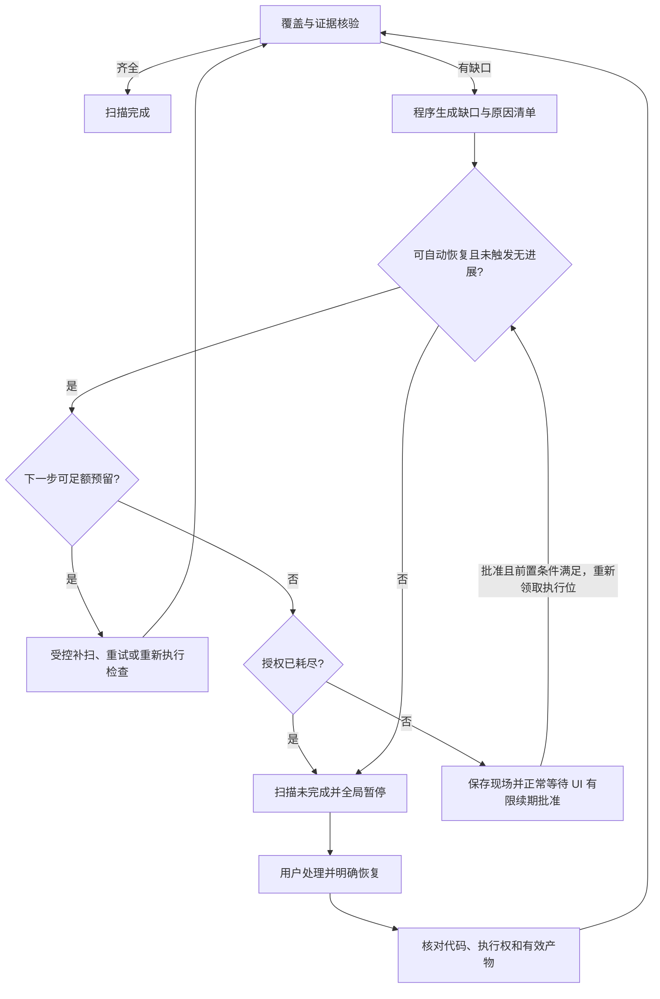

# Q36：扫描缺口的自动补全

状态：Q36 已由用户确认，本文记录已接受的扫描自动补全规则。原有证据门槛、预算上限、已阻塞任务的人工恢复规则继续有效。

标题保留原讨论编号，文件名沿用历史路径；本文不是待批准提案。详细版本与执行边界见[实施契约](implementation-contracts.md)。

## 已确认流程

自动补全发生在正式进入阻塞之前。进入阻塞后，系统不能自行解除全局暂停，也不能把 Worker 崩溃后的待恢复状态自动当作可续跑。

## 可自动处理的范围

| 缺口 | 自动动作 | 完成依据 |
| --- | --- | --- |
| 模块漏扫或审查结果缺失 | 按覆盖账本补扫缺失／失效模块 | 当前版本的实际审查产物 |
| 输入过大、输出截断或结果格式不合法 | 在同一范围内拆小任务并重新执行，记录子范围覆盖关系 | 子范围全部有合法结果且覆盖原范围 |
| 证据引用缺失或日志未正确收集 | 核对可信产物是否存在；不能恢复原始证据时重新执行对应检查 | 受控 Runner 收集的真实结果 |
| 瞬时接口或网络错误 | 在既定策略和剩余预算内有限重试 | 实际请求结果及对应配置记录 |
| 受管执行容器状态异常或依赖未安装 | 确认旧命令已停止后重建受管容器，按仓库已有声明和锁文件准备依赖，再运行检查 | 环境预检及真实检查结果 |
| 目标分支代码变化导致结果过期 | 依 Q28 建立新批次，重算影响范围补扫，必要时全仓重扫；不改写旧批次 SHA | 新版本清单及逐项检查／复用依据 |

原有 Bug 导致的测试失败仍作为基线与缺陷候选，不为了让扫描完成而自动修改业务代码。

## 不能自动越过的边界

- 不修改扫描范围、排除规则或验收标准来掩盖未完成工作。
- 不伪造通过、补写未经执行的日志，或把不适用检查误记为通过；不适用需有明确依据和标识。
- 不自行增加总预算、不无限重试、不自动跨供应商切换；有进展但额度预计不足可按实施契约申请用户批准的有限追加。
- 不索取或猜测凭据，不提升宿主权限，不扩大仓库授权。
- 扫描期间不自动修复发现的业务缺陷，仍先保留本地候选并等待用户选择。
- Worker 异常中断、旧命令状态不明或远程写入结果不明，仍按 Q30 保持暂停并对账／人工恢复。

## 预算、调度与结束条件

- 使用原扫描任务的剩余时长、调用量和恢复轮次上限；默认数值由报告推荐，均可配置。
- 拆分子任务、重试、重建容器和新批次不重置原任务累计预算；补全不是另获一份调用额度。
- 由程序生成恢复计划并控制执行；复用现有处理 Agent 和 Runner，无需增加固定恢复 Agent。
- 自动恢复保留全局重任务执行位，不在旁路启动并行扫描或修复。
- 此处“保留执行位”只指扫描任务内部执行补全；修复任务依赖另一个前置扫描任务时，必须保存现场并释放执行位，让扫描能够运行。
- 每次补全后重新核验版本、范围和证据并更新有效进展；未完成且未触发无进展／安全上限时可在剩余授权内继续，额度预计不足则在耗尽前申请续期；触发无进展、无法恢复或已耗尽时全局阻塞。覆盖／失败指纹、阈值、续期及恢复细则统一见[实施契约 §3](implementation-contracts.md#无进展检测)，新日志、拆分和新批次本身不算进展。
- 自动补全不保证任何缺口均能恢复，不能因此降低“证据齐全才完成扫描”的门槛。

## 对既有规则的调整点

Q16 的“存在缺口即暂停”细化为“先判定是否可在当前预算和授权内补全；不能补全、触发无进展／安全上限或补全耗尽上限后进入阻塞”。后续明确决定允许有进展的复杂任务在耗尽前申请有限追加，等待批准不等于故障；已阻塞仍须处理原因并明确恢复。Q12／Q14 的阻塞后全局暂停、Q30 的异常恢复和 Q35 的模型能力边界不变。
