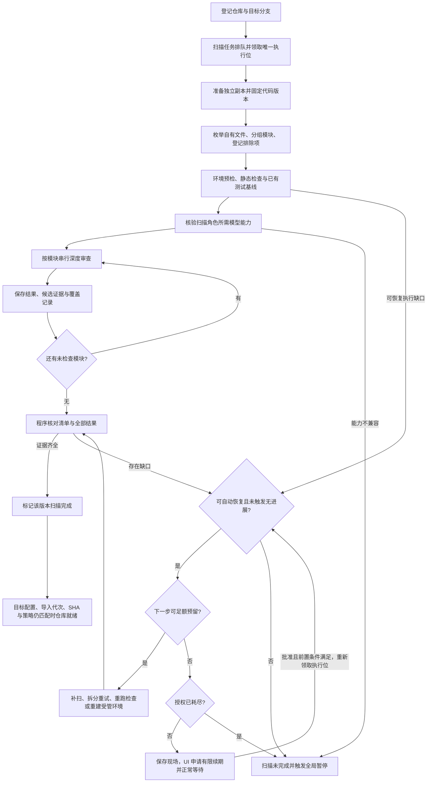
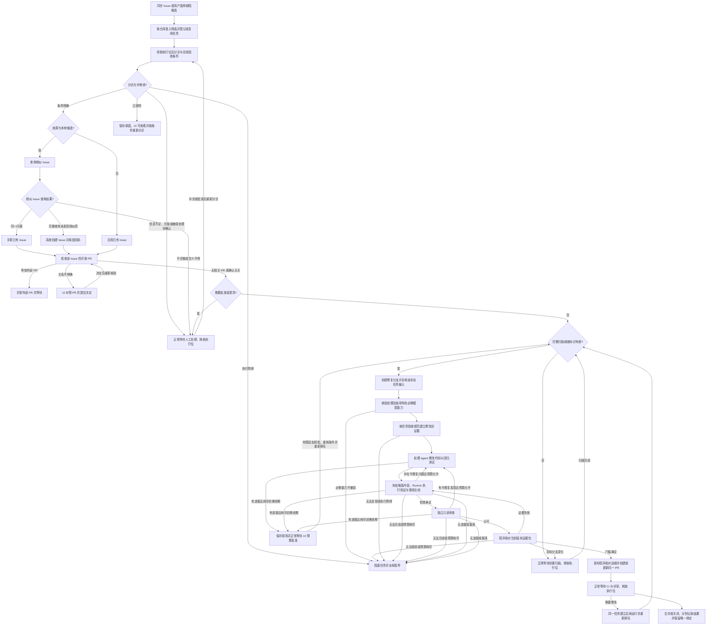
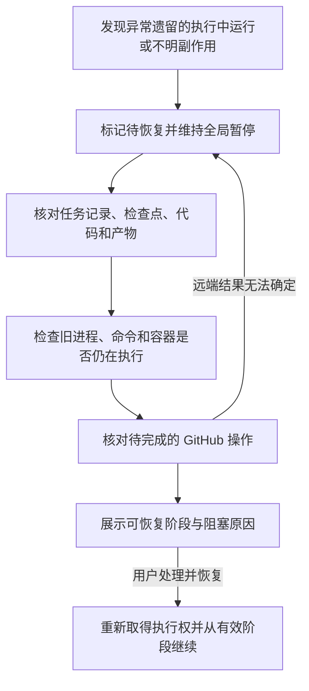

# 扫描、修复与恢复流程

状态：Q1—Q36 已由用户确认。本文记录已确认的流程与故障处理规则，不表示已实现或已通过运行验收；状态标签用于表达行为，最终代码命名可统一。

2026-11-03 已复核流程中的调度与版本边界。字段、预算、暂停、扫描依赖及证据细则见[实施契约](implementation-contracts.md)。

## 对象与状态职责

以下状态标签用于表达行为，代码命名可在实现中统一。

| 对象 | 表达的状态 | 不应混用的含义 |
| --- | --- | --- |
| 受管仓库 | 已登记、扫描中、可自动修复、扫描未完成 | 仓库可处理不等于没有缺陷 |
| 扫描批次 | 排队、建清单、建基线、逐模块审查、覆盖核验、自动补全、完成、阻塞、取消 | 批次完成不能成为所有未来版本的永久结论 |
| 业务任务 | 排队、执行、正常等待、阻塞、结束、取消；执行阶段另记 | 方案／意见确认、耗尽前的预算续期、前置扫描、CI／评审等待可释放执行位，不是执行障碍 |
| 任务运行 | 创建、运行中、完成、中断、失败 | 一次运行完成不等于 Issue 已解决或 PR 已合并 |
| PR | 未创建、已打开、已合并、已关闭未合并 | 关闭未合并不能记为修复已交付成功 |
| 全局调度 | 正常、人工暂停、阻塞暂停 | 暂停不停止只读 GitHub 巡查与状态同步 |

业务数据库是对外权威。检查点、环境、产物和远程状态是恢复时需要核对的依据，不单独决定业务状态。

## Q28 已确认：全仓扫描流程

### 完成和恢复规则

- Harness 生成文件／模块清单及排除记录，逐模块分发任务并保存结果；不能仅凭 Agent 宣称扫描完成放行。
- 每个模块记录扫描版本、输入范围和产物引用。中断后只在原版本与输入仍有效时续扫，覆盖记录不能因进程正常退出就补齐。
- 测试发现原有缺陷与“环境或命令无法执行”分开记录：可解释的已有失败构成基线和候选证据，不自动等同于扫描系统阻塞。
- 目标分支版本变化后旧扫描结论只作为历史，建立新批次补扫；无法可靠确定影响范围时全仓重扫。新版本达到同一覆盖门槛前不能沿用旧就绪结论；同一批次 SHA 保持不变，PR 未合并修改由任务验证覆盖。
- 每次重新导入即撤销旧就绪并执行全仓深度扫描，即使 SHA 相同也不能用旧代次结果放行；同一人工操作的重试不算新导入。目标配置、策略与环境变化的有效性核对见实施契约 §4。
- 扫描与修复使用同一全局重任务执行位。可恢复缺口在原预算和授权内先自动补全，补全后重新核验；无法恢复或耗尽上限才按阻塞规则暂停整个队列。
- 补全复用现有处理 Agent 与 Runner，记录恢复计划与真实结果，不新增固定恢复 Agent、不降低门槛，也不自动解除已进入的阻塞状态。预算、子范围覆盖及源码完整性规则见[自动补全](scan-recovery-proposal.md)与实施契约。
- 各重任务在工具／检查结果及阶段交接时更新有效进展，连续无进展或振荡触发暂停；有进展且额度预计不足时，耗尽前可保存现场并正常等待用户批准有限追加。检测记录与累计消耗不因重启、漂移批次或续期清零；单步超时及阶段安全上限独立生效。规则与初值见[实施契约 §3](implementation-contracts.md#无进展检测)。

用户选择版本变化后补扫受影响范围，无法确定影响时全仓重扫；未选择每次目标分支变化都直接全仓重扫的备选。

## Q29 已确认：修复、验收与 PR 交付流程

### 证据由谁产生、谁判断

- 已有／新增 Issue 按仓库模式准入，六类分诊结果与任务状态分别保存；缺信息、他人占用或敏感处理先通过 UI 澄清／排除，实际复现失败等执行障碍仍全局暂停。默认不 assign 或评论，按仓库明确启用的认领评论由受控发布器执行；准入、占用及优先级／重新分诊细则见[实施契约 §3](implementation-contracts.md#issue-准入与分诊)。
- Issue 与受管 PR 一一对应，返修只更新原 PR，关闭后保留绑定；独立目标须先确认范围再分别建立 Issue／PR。外部竞争 PR 是观测来源，不构成第二个受管绑定，见[实施契约 §8](implementation-contracts.md#issue-与-pr-一一对应)。
- 处理 Agent 可以生成复现步骤、修改和测试，但不能通过自然语言宣布任务已验收或直接持有 PR 发布能力。
- 本地候选经用户选择后，系统先查询目标仓库中相似 Issue；确认同一问题则关联已有 Issue，未发现相似 Issue 才由系统创建 Issue。查询不完整、结果含义不确定或创建结果未对账时等待处理；Issue 身份确认前不建修复分支、不改代码。
- 建分支前及发布前检查该 Issue 的开放 PR。已明确处理同一问题的外部 PR 关联并等待，不启动重复修复；确认无关则继续，只有关系无法判定才通过 UI 请求用户决定。相关 PR 已合入目标分支时直接核验最新扫描／复现证据，确认解决则记录外部修复解决，尚未解决则重核范围后继续；Issue 关闭时也须重新核对当前需求，不按旧快照继续发布。
- 所有人工介入节点均提供 UI 处理入口、证据、可执行动作及结果回读，集中待办与原任务详情互通；覆盖候选／Issue／PR、方案／意见、任务有效性、扫描／复现／验证、环境／权限／模型／预算、异常对账、暂停恢复及 GitHub 评审／合并跳转。提交处理结果后重新核验，不能以人工确认替代证据或自动解除阻塞暂停。完整操作映射见[实施契约 §3](implementation-contracts.md#人工处理入口与操作)。
- Harness 控制验收规范、Runner 与证据收集；被测仓库、测试命令、退出结果和日志须有可追踪版本。
- 新增回归测试须能在修复前代码上证明目标问题，在修复后代码上通过；实际失败原因需与目标问题相符，不能把环境失败当作已成功复现。
- 已批准的功能与纯重构使用方案内明确的验收规范，分别证明目标能力或结构目标与行为保持，不编造修改前 Bug；Bug 的复现门槛不因任务重命名而降低。规范见实施契约。
- 检查基线、修改后验证和独立审查共同构成证据包。独立审查使用独立会话，对代码、需求、测试有效性和证据作判断，不仅复述开发结论。
- 验收命令、测试断言或忽略规则发生变化必须纳入审查；削弱验收标准不能自动换取通过，改变验收标准需要用户确认。
- 证据绑定候选提交／实际内容及环境／配置／验收规范版本；不能只记录 `HEAD` 而遗漏未提交改动。最终验证与审查期间停止处理角色写入，发布树与被测树一致；源码变化后重验及重审。
- 可修复的失败在剩余授权和无进展检测允许时回到修改阶段；真实进展但预计额度不足可在耗尽前申请有限续期，正常等待不全局暂停。无法验证、无法归因、已耗尽或触发无进展／安全上限时进入阻塞；续期不清零账本、不自动解除阻塞。具体行为见[续期契约](implementation-contracts.md#进度驱动的预算续期)。
- 提交前证据与 PR 创建后的 CI 结果分开记录；只在 PR 存在后才能启动的检查，不能被伪称为提交前已通过。按预设验收证据门槛创建 PR 后再跟进专属检查；若目标问题只能在 PR 环境验证且无其他有效提交前证据，保持阻塞（Q34）。
- 发布正文由程序按已验证产物组织，包含概述、变更内容、设计方案／说明、验证／验收和 review 记录。

### PR 人工评审未通过

只读同步保存评审 ID、对应提交和意见，Worker 在同一主任务上安排后续运行。明确的范围内修改自动返修；歧义或新增功能／大型重构／验收变更先等待确认。返修排队期间不抢占其他重任务，从最新 PR head 继续，重新验证与独审后更新原 PR；预算继续累计，不因新运行重置。

每轮仅确认自己领取的反馈修订，运行期间的新意见继续待处理。区分上游 base、旧 PR head 与新候选，原 Bug 不要求在已修好它的旧 PR head 上重新失败；最终仍覆盖完整 PR 的回归和独审。CI 取当前策略要求的最新适用尝试，详情见实施契约 §5、§7—8。

审批、CI 与合并分别记录。PR 关闭未合并不等于 Issue 已解决，也不自动另建替代 PR。若评审／CI 证据推翻原修复结论，关联成功记忆暂停复用并待复核；纯格式建议不自动否定已验证修复。

## 巡检与记忆在主流程中的位置

- API 进程的只读同步循环按活跃仓库约每 2 小时、空闲仓库每天一次读取 GitHub，不占重任务执行位；不调用模型。首次同步、人工同步和发布前读取按需要执行。
- 仓库“检查更新”立即触发只读同步并检查目标分支 SHA；发现变化后登记前置扫描，显示同步与扫描状态，不视为重新导入。读取及去重细则见[实施契约](implementation-contracts.md#7-巡检分诊和变更同步)。
- 同步保存对象和待分析／返修信号；Worker 取得执行位后分诊、生成方案或修复。全局暂停期间信号继续积累，模型分诊及修复等待显式恢复。分页去重、水位提交、活跃判定及同步失败规则见实施契约。
- 调查前检索当前仓库与允许共享的有效经验，失败经验只作避坑参考。验证及独审通过后自动提炼，原始上下文按仓库留存，共享内容提炼去敏；记忆原文、状态及版本为事实源，索引可重建。
- 记忆的来源、编辑／删除、运行快照和反馈纠错见[接入设计](integration-discussion.md)与实施契约；经验不能替代本次复现、回归与审查。

## Q30 已确认：数据库任务队列与恢复对账

### 正常执行

1. API 在数据库保存任务和人工操作，返回持久任务标识。
2. Worker 用短事务领取排队任务，并取得唯一的全局执行位；记录租约、心跳和执行标识。
3. 长任务在事务外执行，阶段产物和必要的检查点持续保存。
4. 正常等待在旧写命令结束／隔离后释放执行位；执行障碍持久化全局暂停状态，不再领取常规重任务。修复需要补扫时让出执行位，不能占位等待另一个扫描任务。
5. 模型调用与工具执行只由 Worker 的有效运行发起，带执行代次校验；模型分诊、方案和提炼不在 API／巡检旁路运行。明确排障模式不会解除暂停。

### Worker 中断或宿主重启

### 副作用和状态不一致

- 检查点与业务记录不默认共用一次原子提交，恢复时须对账。
- 保存 GitHub 操作意图、稳定操作标识与结果；创建 PR 回执丢失时先查询仓库、分支和远端状态，确认是否已创建。
- 无法确定远端结果时继续阻塞，不能直接重发。重复事件或人工恢复请求须有去重与版本校验。
- 租约过期不等于旧进程已停止。复用工作区或重新执行前先排除旧命令继续写入的可能，无法核验时保持暂停。
- 单纯 API 重启不应中断仍正常运行的 Worker；无未结束任务的正常启动与异常恢复分开处理。
- 已记录的正常等待、图中断与安全挂起不自动视为异常遗留；判断依据是运行／执行权／旧命令，而不是“仍有未关闭 PR”。备份恢复还需核对备份后可能发生的远程写入。

用户选择数据库持久队列，未选择专用任务中间件。执行权、人工恢复与远程对账属于应用职责，不由数据库锁或框架 checkpoint 自动保证。

## 相关已确认规则

- Q31：结构化交接、子任务默认串行、工作区单写、按角色授权，凭证留宿主模块。
- Q32：本地混合检索，业务事实源与可重建索引分离，语义不可用时明确降级。
- Q33：用户 token 与本地条件轮询，按仓库／贡献路径适配权限。
- Q34—Q35：提交前证据与 PR 专属 CI 分开，模型能力准入、配置快照和失败后人工恢复。
- Q36：扫描缺口在原预算和授权内先自动补全，无法恢复或耗尽上限才转入全局阻塞。
- 主状态机代码命名、具体组件版本、embedding 模型和阈值由报告给出候选与验证实验；不改变已确认的状态语义和验收原则。
