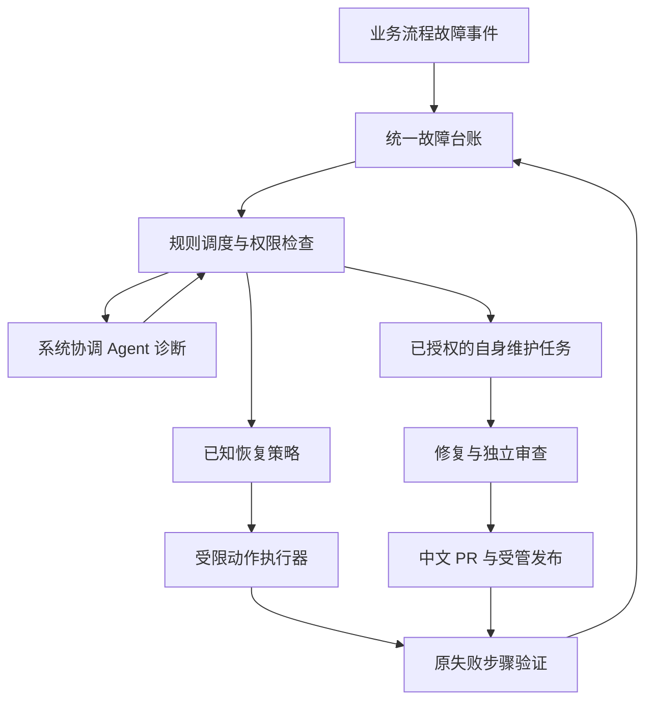

# Design

## Context

动机见 `proposal.md`。本设计以 2026-10-28 已部署的 `a0bfd4013785c062222fcdc005182943f6fc4860` 代码快照作只读实现依据。规划文件位于项目根目录；该目录当前是 `feature/schedule-history`、提交 `f3dfed63`，与部署目录不同，不能据此宣称主干或运行版本已更新。实施前须重新确认 GitHub 实际默认分支及最新提交。

| 已观察到的实现 | 对设计的约束 |
| --- | --- |
| `app.py:create_app` 分别启动执行、诊断、分析、修复、验收和发布 worker | 增加统一协调入口，保留业务 worker，避免创建另一套执行事实来源 |
| `repository_analysis.py` 保存 `failure`、`required_read_validation`、`model_configuration` 等事件 | 复用稳定事件与实际模型配置，不能仅记录最终中文报错，也不能用当前配置反推历史请求 |
| `required_read_validation` 对范围登记只允许一条调用，`too_many_calls` 不走缺失调用纠正 | 第一阶段完整记录该检查；第二阶段实现受限范围批次恢复，不在第一阶段改变前置检查 |
| `report_scheduler.py` 持久化 32 次请求、1800 秒总时限与三次审查续办，且保留已用预算 | 中央调度接入现有计数与检查点；不得转交角色后清零或绕开上限 |
| `repairs.py` 已有审查拒绝、验证、输出和协议恢复；`acceptance.py:_followup` 只沿用已由用户确认的发现 | 整合已有恢复条件；不把系统诊断当作新的用户确认，不产生第二个独立恢复竞争者 |
| `roles.py` 定义五角色；`analysis_model.py`、供应商路由及旧批量保存接口依赖此集合 | 新角色需要配置版本兼容与单独流程，旧五角色批量保存不能偷偷配置第六角色 |
| `observability.py` 的 Langfuse 是可选元数据追踪，包含允许字段与追踪关联事件 | 本地台账独立于 Langfuse 可用性，复用最小披露原则，不复制模型原始正文 |
| `/api/system` 当前声明合并为 `owner_only` | 阶段四默认停在合规 PR；阶段五的自动合并必须是明确新增、独立授权的策略 |
| `scripts/start.ps1` 跟随脚本目录选择代码和前端，并可顺延端口 | 受管重启改由部署清单指定，防止从旧目录启动或以新端口掩盖冲突 |

已有验证入口包括 `tests/test_analysis_prerequisites.py`、`test_analysis_report_recovery.py`、`test_analysis_auto_recovery.py`、`test_analysis_handoff_recovery.py`、`test_acceptance_recovery.py`、`test_repair_output_recovery.py`、`test_model_providers.py` 和前端端到端测试。规划不执行这些测试或真实模型。

## Goals / Non-Goals

**Goals:**

- 将故障事实、诊断计划、恢复动作和真实验证结果分开持久化，使重启后仍能解释每一次动作。
- 第一阶段形成可独立交付的统一台账；其余阶段在同一契约上增量启用。
- 保留业务队列与任务状态权威，中央协调通过受限适配器调用，避免绕过已有校验。
- 为 RepoWatch 自身维护和受管发布建立独立授权，复用修复与审查能力。

**Non-Goals:**

- 不以“自愈”为理由任意执行命令、读取全部凭据、变更用户权限、重置预算或放宽验收。
- 不把目标仓库业务测试失败、环境限制和系统实现错误自动归为同类代码缺陷。
- 不在第一阶段新增模型角色、修改超时上限、自动修补代码或启用远程写入。
- 不在本轮规划实施任何运行逻辑、数据库迁移、发布或服务重启。

## Decisions

### 1. 由持久化规则调度器控制执行，Agent 提出诊断与动作

采用“来源 worker → 本地故障台账 → 规则决策/协调计划 → 受限执行器 → 原流程验证”的结构。新增 `system_coordinator` 只拥有诊断与调度工具，不直接获得 shell、数据库写入或审核批准工具。

替代方案是让中央模型掌握整个业务循环或替换全部 worker。未采用：业务执行已具备版本、确认和预算约束，迁移整个流程会扩大回归面；中央模型故障也不应阻断记录与规则恢复。

### 2. 第一阶段使用事件信箱与双层故障台账

沿用 SQLite 与现有事务模式，建议新增 `system_faults.py`、`fault_sources.py` 及以下逻辑表：

| 数据实体 | 职责与关键字段 |
| --- | --- |
| `system_fault_outbox` | 来源事务内登记稳定 `source_event_key`、来源引用、脱敏最小快照、采集状态；避免依赖远程追踪保证交付 |
| `system_fault_occurrences` | 每次出现的 `occurrence_id`、唯一来源键、账号/仓库/环境、根任务/尝试/事件、流程/角色/阶段、时间、错误类别、字段诊断、执行确定性、预算快照、模型绑定、版本依据、追踪引用、处理状态 |
| `system_faults` | 聚合键、首末时间、出现次数及摘要；展示状态由所属出现记录计算，不能由一条成功覆盖其他失败 |
| `system_fault_history` | 单调追加的状态、动作及验证摘要，保留执行者、时间、原因和证据引用 |
| `system_fault_ingestion` | 各来源补采游标、最近成功时间和受限采集错误，支持断点恢复与可见采集健康状态 |

来源唯一键由流程、任务、尝试和稳定事件标识构成，使用唯一约束保证重复交付不增加次数。来源无事件表时，在状态版本更新事务中产生稳定故障事件，不用采集时间生成身份。

聚合使用账号/仓库/环境、流程/阶段、错误码、结构化违反类型、预期工具、字段路径类别、实际模型绑定和执行依据版本。发生时间、完整错误正文、任务 UUID 不参与聚合。同类问题跨版本用单独分类关联，不合并权限、预算和恢复结论。

状态以出现记录为单位：`pending → diagnosing → recovering → verifying → resolved`；可进入 `blocked` 或由用户以原因标记 `dismissed`。受阻后出现新授权或策略可重新诊断，但保留历史。`dismissed` 不代表修复成功；聚合内存在活动或受阻记录时必须展示剩余数量。

第一阶段接入：

- 分析：关联 `failure` 与最近对应请求的 `required_read_validation`、参数/交接检查、`model_configuration`、追踪与重试记录。
- 执行和诊断：记录系统/环境故障；目标项目测试失败保留来源分类，不能自动升级为 RepoWatch 缺陷。
- 修复、审查、验收和远程发布：在真实失败事务或来源事件中生成信箱记录，保留已有恢复动作和结果。
- 服务启动和退出：阶段一通过启动可见的失败记录接入；完全退出期间的发现与重启能力在阶段五由外部监护补齐，不能宣称阶段一已提供离线监控。
- 信箱/来源采用游标批量补采；新增故障可自动采集，历史扫描为显式只读补录，不触发执行。既有台账写入失败不影响原任务事实，来源重放负责补齐；数据库整体不可写时仅有界记录非敏感本地诊断并显示采集受阻，不承诺零丢失。

替代方案是仅依赖 Langfuse 或在错误显示时临时生成记录。未采用：追踪可被关闭且会离线，页面可能无人访问，两者不能作为本地故障的可靠来源。

### 3. 限制数据披露并提供单一故障入口

采用允许字段构造诊断，不直接保存 `str(exception)`、请求头、完整 URL、密钥、原始模型输出或推理。字段错误只保存路径、约束、期望类型和实际类型；URL 只保留允许的供应商引用。实际模型信息从本次请求绑定取得，缺失时标记 `unknown`，不能读取最新配置冒充历史。

单条结构化诊断默认最多 32 KiB，摘要最多 512 字符；超出时记录截断标记，来源引用保留。Langfuse 只关联已有 trace ID 和允许元数据；不可用不阻塞台账。没有可靠单次请求耗时时明确保留整次尝试耗时及其口径，不能将两者混淆。

建议 API：`GET /api/system/faults`、`GET /api/system/faults/{id}` 和分页时间线；状态处理采用带记录版本的独立 POST。复用登录、CSRF、账号和仓库作用域检查，详情按已授权来源过滤。默认每页 50、上限 200，避免一次读取全部历史。

工作台新增“系统故障”入口：列表展示摘要、流程/阶段、次数、首末时间和状态；详情展示结构化检查、来源任务及动作时间线。任务页面只保留简短提示和详情链接。第一阶段仅提供查看、过滤及有原因的关闭，不提供伪造“已恢复”的按钮。

### 4. 恢复适配现有流程，并统一预算与幂等执行

阶段二增加 `recovery_policies`、动作账本和业务恢复适配器。根任务的恢复所有权采用事务领取、租约和版本检查，旧恢复器也必须通过同一动作账本领取，不能新旧并发重试。动作身份绑定来源出现、任务依据、策略版本与动作序号。

动作类型先覆盖：定向参数/结构纠正、退避重试、有效检查点续办、修复反馈循环、远程结果核对和原步骤验证。远程结果未知先查询核对，确认未产生副作用后才重发。

分析继续沿用现有 32 请求、1800 秒与三次续办作为迁移基线，不在第一阶段修改。请求等待期限、退避和各类纠正配额在阶段二参数化，并受剩余总期限约束。根任务预算计入协调诊断、纠正和业务请求；默认协调最多两次计划请求（含一次纠正）、三次恢复动作，遇到业务更小的限制取更小值。未知价格只标记费用不可估算，不能记为零；仍受请求、令牌和时间硬限制。

范围批次采用明确白名单：一次响应最多两条 `register_task_scope`，每条 1～3 项；其他工具保持各自既有策略。批次先校验所有参数、相同 key 的要求、当前范围版本与写入权限，再在同一范围事务中顺序提交并分别返回真实回执。重复交付读取原回执；同 key 内容冲突、混入其他工具或超过批次上限均整批不执行，进行有界纠正，保留原合法内容与未处理条目。不得只取第一条或伪造 SDK 工具成功。

原步骤验证通过才记录 `resolved`。审查拒绝调用现有修复反馈链，独立审查仍拥有最终结论；预算不足、任务取消或依据变化必须退出，不能换任务 ID 规避。

替代方案是仅扩大 `RECOVERABLE` 列表和重试次数。未采用：这不能解决执行确定性、前置批次、重复副作用和阶段权限差异。

### 5. 第六角色通过独立流程增量接入

在 `roles.py` 增加 `system_coordinator`，新增独立协调 flow。修改模型 API、供应商路由、配置导入及 UI 时采用加法兼容；旧五角色批量保存仍只修改原五角色。协调角色默认未配置，原 flow 的 readiness 不依赖它。

计划结构包含故障引用、事实引用、未知项、允许动作、预期结果和验证方式。执行器重新检查当前授权、依据、租约和剩余额度，拒绝任意 shell、直接数据库写入、修改审查结论等请求。协调模型失效只进行有界纠正和规则降级，只有预先授权的备用模型可被选用。

### 6. 自身维护采用专用目标适配器与已有修复能力

新增维护任务绑定 RepoWatch 仓库、相关故障出现记录、基础提交、Issue/PR、分支、补丁、测试及独立 review。复用修复模型和审查器，使用专用维护适配器组织输入和隔离工作区；不能为绕开现有确认要求而向目标仓库的 `analysis_findings` 写入虚假的用户确认。

策略启用后，先核对 `Gwex323` 身份和仓库权限，再查找相似 Issue/PR；关联须有根因和受影响实现证据，不能沿用无关 PR。无对应 Issue 时先创建中文 Issue，再从远程最新实际默认分支建立 `feature/` 分支。验证通过并独立 review 通过后，才创建/更新中文 PR，描述含规定的五部分及 Issue 编号。补丁改变使旧 review 失效。

默认保留 `owner_only` 合并规则。阶段五可由明确的仓库级策略授权自动合并与部署；协调 Agent 不得修改该策略。远程写入按步骤保存意图、关联标识和回执，结果未知时核对远程，禁止重复创建。

### 7. 发布使用版本清单，进程监护独立运行

部署清单至少包含发布 ID、已合并提交、代码绝对路径、解释器、前端资产标识、数据库绝对路径、配置/凭据引用、固定端口、进程身份与上一可用清单。由受管入口使用显式代码路径启动，不能依赖终端当前目录或解释器的旧 editable 安装路径。

发布前核对授权与 GitHub 合并事实、排空或暂停活动任务、备份数据库并检查兼容性；启动后通过就绪检查、运行版本和前端资源核验、原数据绑定、监控初始化及受影响流程验证确认上线。仅 HTTP 200 不足以通过。

监护作为独立 Windows 隐藏进程运行，不依赖模型或 Web 事件循环；使用进程启动时间、命令和清单身份核对目标。只重启已确认的工作台，不终止端口上无关进程。默认十分钟最多三次自动重启，超过后受阻并通知。监护离线事件保存到受限本地队列，在台账可用后幂等补交。

回滚优先恢复上一可用代码/资产清单。新增台账采用加法迁移，旧应用不写新表；存在不兼容数据库迁移或部署后新写入时不自动覆盖整库备份，转入明确受阻的数据恢复流程。

### 8. 分阶段启用，通知与效果均可验收

开关分别控制记录、规则恢复、模型协调、自身维护、GitHub 合并和部署。记录安装后可启用；其余新自动能力默认关闭，阶段验收后按用户授权打开。历史补录记录默认不可执行。关闭自动动作后不再领取新任务，已开始动作在安全边界结束并保存实际结果。

通知按故障与状态版本去重，只在修复完成、最终受阻、需要新授权或服务恢复失败等有意义变化发生；重试过程留在时间线。效果使用故障覆盖率、重复事件去重、恢复完成率、恢复耗时、额外请求和需要人工处理次数评估，不能在规划时承诺所有外部故障都能修复。

## Risks / Trade-offs

- [来源状态与台账分离导致遗漏] → 同事务信箱、稳定事件身份与游标补采；暴露记录器健康状态，数据库整体故障时明确能力边界。
- [同类故障误合并] → 按账号/仓库/执行依据隔离，保留逐次状态；相似分类关联不等于授权和任务合并。
- [旧恢复器与中央调度竞争] → 统一动作领取、租约、版本检查和回执，接入前维持旧单一执行者。
- [模型恢复计划继续失败] → 先支持规则动作，有界纠正，拒绝未知工具；模型故障不影响本地记录与监护。
- [外部调用已成功但本地不知道] → 先保存意图，恢复时核对远程；无法确认时受阻而非盲目重发。
- [自动自修复误改运行系统] → 独立维护工作区、规定 Issue/分支/review/PR 顺序、发布授权和独立验证。
- [版本切换损坏数据或丢失监控] → 显式清单、配置引用、备份、兼容性判断及前后端双重核验。
- [全流程收集导致隐私和存储压力] → 允许字段、长度限制、分页、受限保留策略；不上传原始源码、凭据和模型推理。

## Migration Plan

| 阶段 | 交付与启用范围 | 必须通过的验收 |
| --- | --- | --- |
| 1. 统一故障记录 | 加法表结构、来源采集、脱敏、聚合、查询与故障页面；其余自动化关闭 | 超时和双范围调用均有真实上下文；去重、重启补采、权限、原任务不被执行 |
| 2. 自动恢复机制 | 统一动作账本、策略适配、共享预算、范围批次与检查点验证 | 安全双调用成功、冲突整批拒绝、不重复发布、不清零预算、不覆盖取消 |
| 3. 中央调度 Agent | 第六角色、配置兼容、诊断计划校验、进度和通知 | 原五角色可继续使用；有效计划自动接管；越权拒绝、模型不可用可降级 |
| 4. 自身代码修复闭环 | RepoWatch 维护目标、Issue/PR 查重、隔离分支、验证与独立 review | 确定内部缺陷产出符合规定的中文 PR；未审查通过不创建，目标仓库不被误写 |
| 5. 发布与服务恢复 | 合并部署策略、受管清单、独立监护、回滚 | 从旧目录重启仍加载新清单；原数据库和监控保留；错误进程不被终止 |
| 6. 完整验收与逐步启用 | 隔离环境联合演练、真实故障对照、授权范围内逐步启用 | 故障发现→恢复/维护→验证→原任务续办有完整证据；超预算和真实受阻正确停下 |

实施准备先在 GitHub 落实对应中文 Issue、核验写入身份，再从最新实际默认分支创建 `feature/` 分支；该准备是阶段一的前置条件，不计为额外业务阶段。每阶段可单独 review、PR 和发布；通过前一阶段不自动授权后续阶段。

升级前保留数据库和部署清单备份。阶段一失败可回滚应用并停用采集，保留加法表与旧任务原状态；后续阶段回退时关闭相应开关，禁止清除历史、回执或额度来“恢复运行”。历史数据补录单独选择、标记来源，不自动执行；取消任务和用户关闭记录不会被安装过程复活。

本次只交付规划文档；实际实施须由用户后续启动 apply 工作流。
