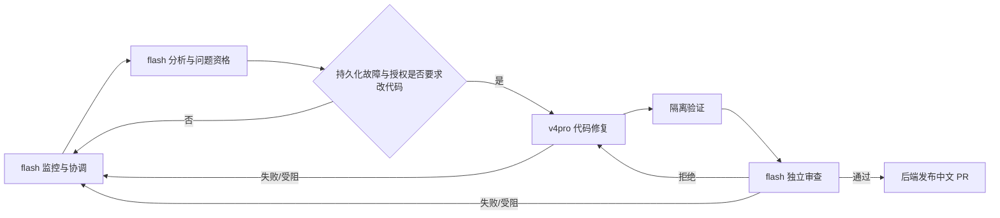

# Design

## Context

动机见 `proposal.md`。当前工作目录位于 `feature/model-escalation-108`，基础提交为最新默认分支 `codex/initial-upload` 的 `5c25840`；GitHub 身份已核验为 `Gwex323`，仓库权限为管理员。

只读检查确认了以下实现事实：

- `roles.py` 已定义五个业务角色和 `system_coordinator`，`FLOW_ROLES` 已把分析、修复、审查和协调映射到不同角色。
- `model_providers.py` 已支持供应商、模型、加密凭据和按角色路由；数据库现有 `deepseek-flash` 与 `deepseek-v4-pro`，但六个角色当前均选择 `glm-5.3`。
- `analysis_model.py` 在任务开始时解析角色模型，并把真实角色模型写入状态与恢复依据；`repair_model.py` 使用不同的修复角色与独立审查角色 Agent。
- `coordination.py` 已持久化故障动作、预算和协调计划，但协调备用模型只用于协调计划本身，不会把代码修复角色提升到 v4pro。
- `repair_settings`、系统故障记录和系统协调均已启用；`Gwex323/gateway-model-assistant` 已登记，最近一次分析失败，历史修复曾创建 Issue #3 和 PR #4。

这些事实意味着“flash 监控后交给 v4pro 修复，再回到 flash”适合在既有角色交接边界实现，不应在一个 Agent 的推理循环中临时更换模型。

## Goals / Non-Goals

**Goals:**

- 增加默认关闭、版本化、可审计的模型升级策略，并沿用现有供应商、角色和凭据体系。
- 在进入明确授权的代码修复阶段时解析 v4pro，在修复阶段结束或失败后把后续阶段交回 flash。
- 让所有模型身份、切换原因、预算和权限可在任务时间线中核对。
- 通过离线验收和 `gateway-model-assistant` 真实链路证明分析、修复、验证、审查和 PR 可完整关联。

**Non-Goals:**

- 不在单独一次模型请求内热切换模型，也不保留同一 Agent 上下文跨供应商重放。
- 不把“发生错误”直接等同于“需要修改代码”，不为任意故障创建修复任务。
- 不改变独立审查、测试、Issue、分支、PR、合并或部署门禁。
- 不将 flash 或 v4pro 的模型名称写死在业务代码中，也不允许策略绕过供应商凭据加密。
- 不在本轮规划中运行真实模型、修改目标仓库、创建远程 PR 或部署服务。

## Decisions

### 1. 以角色交接作为模型切换边界

监控模型用于 `system_coordinator`、仓库分析、问题调查、复现辅助和独立审查；代码修复模型只用于 `repair_agent`。阶段结束后重新建立 Agent，不把监控阶段的工具历史交给 v4pro，也不把 v4pro 的编辑上下文直接交给发布逻辑。

替代方案是在单次 SDK 运行中热切换模型。未采用：不同供应商的工具调用、JSON 协议、推理设置和历史兼容性不同，运行中替换会破坏阶段快照，也难以证明权限未扩大。

### 2. 使用独立的版本化策略，不覆盖现有角色配置

新增只含单例的升级策略配置，保存启用状态、版本、监控路由、修复路由和更新时间。两个路由均引用现有 `model_providers` 中的供应商与模型；策略启用时验证供应商、模型和密钥均存在。

策略关闭时完全沿用当前按角色配置。策略启用时，在解析任务模型时以策略路由覆盖对应角色，但不改写 `agent_model_settings.routes`、角色独立配置或供应商目录。这样停用策略即可恢复原路由，也不会因一次验收永久改变所有者配置。

替代方案是直接修改六个角色的全局选择。未采用：无法区分一次编排与长期配置，且任何配置修改都会使未来任务身份变化，难以回滚。

### 3. 在代码修改动作获准时升级，而非按错误文本升级

升级条件由服务端从已持久化的修复任务、故障出现记录、来源任务状态、授权、剩余预算和允许动作计算。至少同时满足“存在需要修改代码的有效来源”和“当前修复执行仍获授权”才采用修复路由。

超时、鉴权、网络、Docker、外部供应商、预算不足、用户取消和未知故障继续使用原有恢复策略，不由模型自述触发 v4pro。协调角色只能提出既有白名单动作；不得新增“切换模型”工具或任意路由参数。

替代方案是让协调 Agent 根据错误文本选择模型。未采用：错误正文属于不可信输入，模型自述不能作为权限或成本升级依据。

### 4. 每个阶段保存有效模型快照

任务进入分析、修复和审查阶段时，分别保存实际供应商、模型、接口、推理强度、配置版本和凭据依据摘要。阶段执行期间策略或供应商配置变化只影响尚未开始的新阶段；若恢复依据要求模型身份一致，则按现有摘要校验失效规则处理。

修复任务新增最小有效模型快照，至少包含策略版本、监控路由、修复路由和本次阶段角色映射。快照不保存密钥或密文，只保存可重算的身份与凭据摘要。旧任务不补造快照，继续按原有依据解释。

替代方案是在每次请求前动态读取最新配置。未采用：会出现同一阶段前半段使用 flash、后半段使用另一个模型，且恢复时无法判断旧证据是否仍有效。

### 5. 修复结束必须回到监控路径

修复调用结束、验证失败、审查拒绝、策略受阻或发生可记录异常后，系统把控制权交回 `system_coordinator`，后续协调和独立审查重新使用监控快照。成功路径中，v4pro 只负责补丁与修改摘要，独立审查必须由 flash 监控角色完成。

修复反馈循环可以在剩余预算内再次进入修复阶段；每次进入都创建独立阶段快照和新事件，但共用同一根任务预算，不因模型切换创建新的恢复根或重置额度。

替代方案是让 v4pro 同时完成修复和审查。未采用：违反独立审查边界，也不符合回到 flash 监听的要求。

### 6. 通过追加事件和只读界面证明实际路由

新增事件至少记录：策略快照、进入监控、升级到修复模型、返回监控、模型不可用和阶段完成。事件只包含角色、供应商 ID/名称、模型、版本、原因代码和阶段关联，不保存密钥、完整提示词或模型原始输出。

工作台在模型设置中展示策略配置，在修复和系统故障详情中展示实际阶段与切换依据；历史记录没有可靠数据时显示未知。后端状态是唯一事实来源，前端不从当前配置推断历史模型。

替代方案是仅在日志中记录切换。未采用：日志不适合长期审计，也不能与任务、预算和 PR 证据稳定关联。

### 7. 模型升级不改变发布与权限契约

`repairs.py` 和 `github_contributions.py` 继续负责验证后的发布；升级策略只影响 Agent 调用，不提供 GitHub 工具、shell 或数据库写入权限。PR 仍要求中文标题和描述、关联 Issue、验证结果和独立 review。

如果 v4pro 不可用，系统不得静默改用 flash 修改代码，也不得把失败解释为已经修复。系统回到 flash 协调路径，记录 `repair_model_unavailable` 并保持受阻，等待配置修复、明确授权或现有恢复策略决定。

如果 flash 监控模型不可用，现有模型就绪检查阻止新任务开始；已经开始的阶段按原模型快照和失败策略处理。不得因升级策略引入隐式备用模型。

### 8. 真实验收采用分阶段门禁

先完成离线替代模型测试，再在目标仓库执行真实链路。真实运行前核对当前默认分支、源码 revision、目标仓库权限、模型连接、工作台进程版本、活动任务和数据库备份；运行中只按既有 worker 状态推进。

目标仓库没有真实有效问题时，不以空 Issue、空补丁或人为构造缺陷完成验收。若分析发现 RepoWatch 自身缺陷，则按 Issue #108 之后的独立中文 Issue、`feature/` 分支、验证、独立 review 和中文 PR 流程处理；若发现目标仓库真实缺陷，才由 v4pro 修复并走目标仓库发布流程。

PR 创建后停止在等待合并状态；合并、部署和生产工作台切版都需要新的明确授权。

## Risks / Trade-offs

- [flash 审查能力较弱] → 保留原有结构校验、源码证据、独立审查 Agent 和 PR 门禁；不得因为模型更便宜而放宽验证。
- [两个供应商的工具与 JSON 协议不同] → 使用现有供应商适配器和兼容模式，分别保存阶段快照；真实模型验收分别覆盖 flash 与 v4pro。
- [错误触发高成本模型] → 触发只依据持久化修复任务、来源资格、授权和预算；对非代码故障增加反例测试。
- [策略变更破坏运行中恢复] → 阶段快照冻结实际模型，配置变化仅影响未来阶段；恢复依据不一致时明确受阻。
- [模型切换重置预算或产生并行恢复] → 复用现有根任务、租约和动作账本，模型切换不创建新的恢复根。
- [目标仓库身份或权限不符] → 发布前核验账号、仓库和作用域；失败时保留本地证据，不切换账号或重复创建远程内容。
- [真实验收产生重复 PR] → 复用现有远程操作回执和发布前查询，先核对已有 Issue/PR 再创建；文本相似不足以合并远程对象。
- [策略长期开启带来成本变化] → 默认关闭，配置与时间线明确展示实际模型；所有者可随时停用并恢复原角色路由。

## Migration Plan

1. 以加法迁移创建升级策略存储，默认关闭；不改变现有供应商、角色选择和凭据。
2. 发布后先只启用只读状态和离线测试，确认策略关闭时原路由与恢复摘要保持一致。
3. 在隔离数据库启用策略，验证阶段快照、预算连续性、失败回路和发布门禁。
4. 备份生产数据库并记录部署清单，再按明确授权开启真实目标仓库验收；不自动重跑历史失败任务。
5. 若真实运行发现 RepoWatch 代码缺陷，停止该轮验收，按仓库规定登记 Issue、建立 `feature/` 分支、修复、审查后再继续。
6. 回滚时先关闭升级策略，再回退应用；保留加法表和事件作为历史证据，不删除任务、预算或远程回执。

## Open Questions

无。目标仓库固定为 `Gwex323/gateway-model-assistant`，真实模型名称和供应商由现有目录在启用时解析；若启用时对应模型或权限不存在，任务按规格受阻，不能由规划自行替换。
